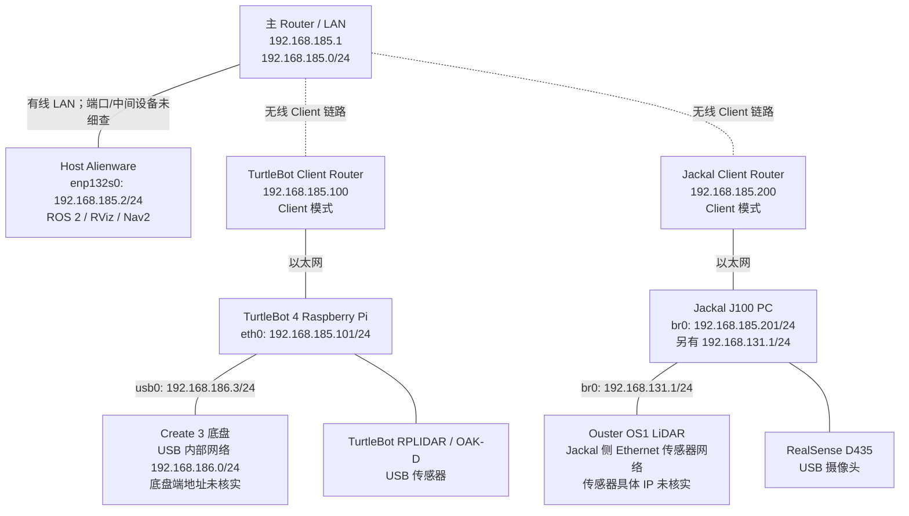

# Host + TurtleBot 4 + Jackal J100 — Network Topology and Configuration

**记录日期：** 2026-10-09  
**目标：** Host、TurtleBot 4 和 Jackal J100 位于同一 `192.168.185.0/24` 二层 LAN，通过 ROS 2 Jazzy / Fast DDS（Domain 0）互相发现和交换数据；各机器人保留自己的内部传感器/底盘网络。  
**标记：** ✅ 实际输出/测试确认 · ⚠️ 待验证或仅规划

## 1. 物理与逻辑拓扑（已按实际组网更正）

**主 Router：`192.168.185.1`；TurtleBot 侧 Client Router：`192.168.185.100`；Jackal 侧 Client Router：`192.168.185.200`。** 后两台路由器运行 **Client 模式**，提供连接到主 Router 所在网络的无线客户端链路。主机的 ROS 2 地址分别是 Host `.2`、TurtleBot `.101`、Jackal `.201`，**不要混淆 Client Router 地址与机器人地址**。



> 图中 Client 模式和路由器地址由本次用户更正确认；无线连接用虚线表示逻辑 Client 链路。具体设备的桥接/转发实现、链路端口与 Multicast 透传行为需按实际设置验证。此前 Host 与两台机器的 ROS 2 Topic 通信均已实测成功。

**NETGEAR GS108Tv3 目前保持出厂默认设置，尚未纳入现有组网，因此不出现在本网络拓扑中。**

**Fast DDS 主网络：** `192.168.185.0/24`；三个 ROS 2 主机使用 `ROS_DOMAIN_ID=0`。Jackal 另外保留 `192.168.131.0/24` 传感器子网，TurtleBot 保留 `192.168.186.0/24` Create 3 USB 子网。

## 2. IP 地址与接口清单

| 设备 | 接口 | IPv4 / 掩码 | 用途 | 验证 |
|---|---|---|---|---|
| Host Alienware | `enp132s0` | **192.168.185.2/24** | 三机 ROS 2 Ethernet LAN | ✅ `ip` / `ifconfig` |
| Host Alienware | `wlp131s0f0` | `10.20.47.233/17` | NYU Wi-Fi / Internet | ✅ 当时实测，DHCP 可能变化 |
| Host Alienware | `docker0` | `172.17.0.1/16` | Docker 内部桥 | ✅ 当时实测，接口曾为 DOWN |
| TurtleBot 4 Raspberry Pi | `eth0` | **192.168.185.101/24** | 外部 ROS 2 LAN | ✅ Netplan 应用、重启后确认 |
| TurtleBot 4 Raspberry Pi | `usb0` | **192.168.186.3/24** | Raspberry Pi ↔ Create 3 USB 网络 | ✅ 保持不变、重启后确认 |
| TurtleBot 4 Raspberry Pi | `wlan0` | `10.33.16.163/23` | NYU Wi-Fi | ✅ 当时实测，DHCP 可能变化 |
| Jackal J100 | `br0` | **192.168.185.201/24** | 对外 ROS 2 / Fast DDS | ✅ Netplan 应用及重启后确认 |
| Jackal J100 | `br0` | **192.168.131.1/24** | 既有传感器 Ethernet 子网 | ✅ Netplan 应用及重启后确认 |
| Jackal J100 | `enp3s0` | 无独立 IP | `br0` Bridge port；此前 `LOWER_UP` | ✅ 此前观测 |
| Jackal J100 | `enp4s0` | 无独立 IP | `br0` Bridge port；此前 `NO-CARRIER` | ✅ 此前观测 |
| Ouster OS1 | Ethernet | **未核实**（曾讨论 `192.168.131.20` 作为示例） | Jackal LiDAR UDP 数据 | ⚠️ 不把示例地址当实测 |
| Create 3 底盘 | USB Ethernet | **未核实**（位于 `192.168.186.0/24`） | 底盘控制、里程计等 | ⚠️ 待查 Create 3 端 IP |
| 主 Router | LAN | **192.168.185.1** | 主 LAN / TurtleBot 当前默认网关地址 | ✅ 用户确认；设备参数未单独采集 |
| TurtleBot Client Router | 管理地址 | **192.168.185.100** | Client 模式，连接主 Router 与 TurtleBot 以太网 | ✅ 用户确认 |
| Jackal Client Router | 管理地址 | **192.168.185.200** | Client 模式，连接主 Router 与 Jackal 以太网 | ✅ 用户确认 |

所有 Linux 设备另有回环地址 `127.0.0.1/8`。以上只汇总实际出现的 IPv4 地址，不含尚未收集的 IPv6 地址。

## 3. ROS 2 / Fast DDS 配置

| 项目 | Host | TurtleBot 4 | Jackal J100 |
|---|---|---|---|
| ROS | Jazzy | Jazzy | Jazzy |
| `ROS_DOMAIN_ID` | `0` | `0` | `0` |
| RMW | `rmw_fastrtps_cpp` | `rmw_fastrtps_cpp` | `rmw_fastrtps_cpp` |
| Discovery | `SUBNET` | `SUBNET` | `SUBNET` |
| DDS 配置文件 | 未见自定义 XML 生效证据 | `/etc/turtlebot4/fastdds_rpi.xml` | `/home/robot/fastdds_185.xml` |
| 外部 ROS IP | `.185.2` | `.185.101` | `.185.201` |
| Namespace | Host 各程序自行选择 | 目前大多数 `/` | `/j100_0949` |

### Jackal：为什么需要自定义 Fast DDS 配置

Jackal `br0` 同时包含 `192.168.131.1` 和 `192.168.185.201`。原先大量 DDS Discovery 以 `192.168.131.1` 为源地址发出；Host 仅有 `.185.2` 时看不到全部 Jackal Topics。给 Host 临时加上 `192.168.131.101/24` 后立刻能看到全部 Topics，证明 `131` 地址可达性与问题密切相关。

Jackal 已验证的 Fast DDS 2.14.6 XML：`/home/robot/fastdds_185.xml`，其 UDPv4 `interfaceWhiteList` 包含 `127.0.0.1` 和 `192.168.185.201`，并使用 `useBuiltinTransports=false` / 自定义 UDP-only transport。此配置**不是默认共享内存配置**，大带宽传感器要留意 CPU、带宽和丢包。配置已通过 systemd drop-in 应用到以下服务：

```text
/etc/systemd/system/clearpath-platform.service.d/10-fastdds.conf
/etc/systemd/system/clearpath-sensors.service.d/10-fastdds.conf
```

均包含：

```ini
[Service]
Environment="FASTRTPS_DEFAULT_PROFILES_FILE=/home/robot/fastdds_185.xml"
```

`clearpath-robot.service`、`clearpath-platform.service`、`clearpath-sensors.service` 均已验证 `enabled`，且 Platform / Sensors 为 Robot 的 `PartOf`、`WantedBy` 服务。经重启后 Host 与 Jackal 的 Topic 列表一致，证明自动加载配置基本正常。

**重要：** 之前曾为两端临时添加 `224.0.0.0/4` 出站组播路由；后续 Jackal `ip route get 239.255.0.1` 曾返回 `Network is unreachable`，但新 DDS XML 仍能正常发布 Discovery 与数据。**不要以为该组播路由已经永久写入 Netplan**；当前也没有证据表明需要将其持久化。

### TurtleBot Fast DDS

`/etc/turtlebot4/fastdds_rpi.xml` 的已读内容仅定义默认 Participant，不含旧地址 `192.168.185.3` 或 IP allowlist。改 `eth0` IP 后 Host 成功订阅 `/odom` 与 `/scan`。TurtleBot Create 3 的内部 DDS / USB 通信使用 `usb0` 子网，迁移时未修改 `usb0`。

## 4. ROS Topic 隔离与各自运行

**当前不强制改变 Namespace 或 Domain。** 在相同 Domain 0 上，两台机器人可在各自设备或 Host 上启动独立的 ROS 程序，只要对准其自己的 Topics、TF、动作和控制接口。

| 功能 | TurtleBot 4 | Jackal J100 |
|---|---|---|
| Odometry | `/odom` | `/j100_0949/platform/odom` |
| 2D LiDAR | `/scan` | `/j100_0949/sensors/lidar3d_0/scan` |
| IMU | `/imu` | `/j100_0949/sensors/imu_0/data` |
| 运动控制 | `/cmd_vel`（注意安全） | `/j100_0949/cmd_vel`（注意安全） |
| TF | `/tf`, `/tf_static` | `/j100_0949/tf`, `/j100_0949/tf_static` |
| RGB Camera | `/oakd/rgb/preview/image_raw` | `/j100_0949/sensors/camera_0/color/image` |
| Depth Camera | 根据 TurtleBot OAK-D 运行 Topic 具体确认 | `/j100_0949/sensors/camera_0/depth/image` |

Jackal Nav2 验证：Host 上 `clearpath_nav2_demos` 使用 `/j100_0949` Namespace，`/j100_0949/odom → /j100_0949/platform/odom`，内含的 `navigation_launch.py` 将 `/tf` 和 `/tf_static` 重映射为相对 `tf` / `tf_static`；`map → odom → base_link` 变换经 `tf2_echo` 验证；Lifecycle 日志出现 **`Managed nodes are active`**。这证明 Nav2 Lifecycle 已激活，**不等于已验证运动导航安全性**。

## 5. 已验证的跨机器数据

| 方向 | 数据 | 观测结果 |
|---|---|---|
| Jackal → Host | `/j100_0949/platform/odom` | ≈ **50 Hz** |
| Jackal → Host | `/j100_0949/sensors/camera_0/color/image` | ≈ **29.6 FPS** |
| Jackal → Host | `/j100_0949/sensors/camera_0/depth/image` | ≈ **14–15 FPS**（驱动设置 `640,480,15`） |
| TurtleBot → Host | `/odom` | ≈ **20 Hz**（改 IP、重启后验证） |
| TurtleBot → Host | `/scan` | ≈ **8.1 Hz**（改 IP、重启后验证） |
| Jackal → Host | DDS Discovery UDP/7400 | tcpdump 出站源地址均为 `.185.201`（抽样 15 包） |

最近 Host Topic 列表显示 Ouster 的多项 Topics（`points`、`scan`、`lidar_packets` 等），但**Topic 存在不自动证明对应时间点 LiDAR 硬件在线或持续产生数据**，应以频率、Driver 状态与设备连接检查为准。

## 6. 网络持久化配置位置

### Jackal（systemd-networkd / Netplan）

```text
/etc/netplan/50-cloud-init.yaml
```

关键部分（其余 Bridge ports / DHCP 配置保留原样）：

```yaml
bridges:
  br0:
    addresses:
      - "192.168.131.1/24"
      - "192.168.185.201/24"
    dhcp4: true
    dhcp6: false
```

已验证 `netplan generate`、`netplan try` 接受并通过重启保留两地址。注意 `dhcp4: true` 表示未来接入 DHCP 网络时可能获得第三个动态地址。

### TurtleBot（NetworkManager / Netplan）

```text
/etc/netplan/40-ethernets.yaml
```

关键部分：

```yaml
ethernets:
  eth0:
    dhcp4: false
    optional: true
    addresses:
      - 192.168.185.101/24
    routes:
      - to: 0.0.0.0/0
        via: 192.168.185.1
      - to: 192.168.0.0/24
        via: 192.168.185.1
  usb0:
    dhcp4: false
    optional: true
    addresses:
      - 192.168.186.3/24
```

已验证 `netplan try`、重启后 IP、Host 侧 `/odom` 与 `/scan` 正常。

**Host** `enp132s0` 静态 IPv4 已观测为 `.185.2/24`；其永久 NetworkManager/Netplan 配置文件尚未在记录中确认。

## 7. 主 Router 与两台 Client Router（当前组网）

| 网络设备 | 管理 IP | 模式 | 对接设备 |
|---|---|---|---|
| 主 Router | **192.168.185.1** | 主 LAN / 网关 | Host、无线 Client Router |
| TurtleBot 侧 Router | **192.168.185.100** | Client | TurtleBot 4 `eth0: 192.168.185.101` |
| Jackal 侧 Router | **192.168.185.200** | Client | Jackal `br0: 192.168.185.201` |

- 三台 ROS 2 主机处于同一 `192.168.185.0/24` IPv4 网段，已经实测 Odometry、LiDAR 和 Camera Topics 跨设备可用。
- 需要 Client Router **实际透传 DDS 所需的 Multicast / UDP 和设备间 Unicast**；“Client 模式”这一名称本身不保证透明二层桥接。当前验证结果表明已有所需的通信路径，但改变无线或路由器设置后应重新测试。
- TurtleBot 的 Netplan 默认路由和到 `192.168.0.0/24` 的静态路由均经 `192.168.185.1`；不要把 `.100` 或 `.200` 错设为机器人自身 IP 或默认网关。
- Host 的 Wi-Fi 可能影响默认 Multicast 出口选择；出现 Topic 消失时，先确认 `ip -4 route get 239.255.0.1` 和 DDS 实际发送的接口。
- **GS108Tv3 暂未接入，仍是默认配置；不属于当前网络拓扑，也不在本文件内指定管理 IP / VLAN / IGMP Snooping 参数。**

## 8. 常用无修改检查命令

```bash
# 各机查看地址和路由
ip -br -4 addr
ip -4 route

# Host 检查到两台机器的单播路由
ip -4 route get 192.168.185.101
ip -4 route get 192.168.185.201

# ROS Domain / RMW / 配置
printenv | grep -E '^(ROS_|RMW_|FASTRTPS_|FASTDDS_)'

# Host 区分两台机器的数据源
ros2 topic list | grep '^/j100_0949/'       # Jackal
ros2 topic info /odom -v                    # TurtleBot（如无别的发布者）

# 数据传输（Host）
ros2 topic hz /odom
ros2 topic hz /scan
ros2 topic hz /j100_0949/platform/odom
ros2 topic hz /j100_0949/sensors/camera_0/color/image
ros2 topic hz /j100_0949/sensors/camera_0/depth/image

# 观察 Fast DDS Discovery（Jackal）
sudo timeout 10s tcpdump -ni br0 'udp and dst host 239.255.0.1 and dst port 7400' -c 15

# 查看 Jackal Services
systemctl is-active clearpath-platform clearpath-sensors
systemctl show clearpath-platform -p Environment --no-pager
systemctl show clearpath-sensors -p Environment --no-pager
```

## 9. 与网络无关、但当前仍待解决的问题

Host 的 RViz 在启动时出现 `Unable to create glx context`、`BadValue`，同时 `nvidia-smi` 出现 `Driver/library version mismatch`。当时加载的 NVIDIA Kernel Module `580.173.02` 与安装的用户空间 `580.178.04` 不一致；**这是 Host OpenGL/驱动问题，而不是 ROS 2 LAN 故障**。建议确认重启后 `nvidia-smi` 和 `glxinfo -B`，再启动 RViz。

---

**整体结论（截至 2026-10-09）：** `Host .185.2`、`TurtleBot .185.101`、`Jackal .185.201` 已经成功共享 ROS 2 Fast DDS Domain 0，并且关键 Topic 的跨机器数据传输及机器人重启后的 IP 持久化得到验证。当前连接采用主 Router `.185.1` 加两台 Client Router `.185.100` / `.185.200`；GS108Tv3 尚未接入。下一阶段为后续 SLAM/Nav2 实测和 Client 链路稳定性验证。
