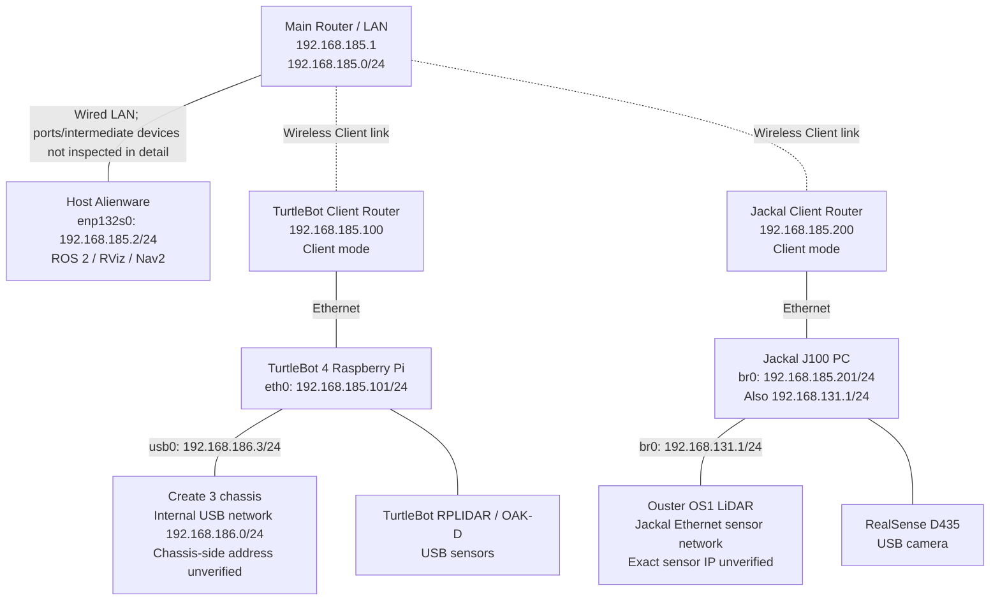

# Host + TurtleBot 4 + Jackal J100 — Network Topology and Configuration

**Recorded on:** 2026-10-09<br>
**Objective:** Host, TurtleBot 4, and Jackal J100 share the same `192.168.185.0/24` Layer-2 LAN for discovery and data exchange through ROS 2 Jazzy / Fast DDS (Domain 0); each robot retains its internal sensor/chassis networks.<br>
**Legend:** ✅ Confirmed by actual output/testing · ⚠️ Unverified or planned only

## 1. Physical and logical topology, corrected to match the actual network

**Main Router: `192.168.185.1`; TurtleBot Client Router: `192.168.185.100`; Jackal Client Router: `192.168.185.200`.** The latter two operate in **Client mode**, providing wireless client links to the main router's network. ROS 2 host addresses are Host `.2`, TurtleBot `.101`, and Jackal `.201`. **Do not confuse Client Router addresses with robot addresses.**



> Client mode and router addresses were confirmed by the user's correction. Dashed wireless lines represent logical Client links. Verify each device's bridging/forwarding implementation, ports, and multicast forwarding against its actual settings. ROS 2 topic communication between the Host and both robots has already succeeded in tests.

**The NETGEAR GS108Tv3 remains at factory defaults and is not connected to the current network, so it is absent from this topology.**

**Main Fast DDS network:** `192.168.185.0/24`; all three ROS 2 hosts use `ROS_DOMAIN_ID=0`. Jackal also retains its `192.168.131.0/24` sensor subnet; TurtleBot retains its `192.168.186.0/24` Create 3 USB subnet.

## 2. IP addresses and interfaces

| Device | Interface | IPv4 / mask | Purpose | Verification |
|---|---|---|---|---|
| Host Alienware | `enp132s0` | **192.168.185.2/24** | Three-host ROS 2 Ethernet LAN | ✅ `ip` / `ifconfig` |
| Host Alienware | `wlp131s0f0` | `10.20.47.233/17` | NYU Wi-Fi / Internet | ✅ Observed then; DHCP may change |
| Host Alienware | `docker0` | `172.17.0.1/16` | Internal Docker bridge | ✅ Observed then; interface was DOWN |
| TurtleBot 4 Raspberry Pi | `eth0` | **192.168.185.101/24** | External ROS 2 LAN | ✅ Netplan applied and verified after reboot |
| TurtleBot 4 Raspberry Pi | `usb0` | **192.168.186.3/24** | Raspberry Pi ↔ Create 3 USB network | ✅ Unchanged and verified after reboot |
| TurtleBot 4 Raspberry Pi | `wlan0` | `10.33.16.163/23` | NYU Wi-Fi | ✅ Observed then; DHCP may change |
| Jackal J100 | `br0` | **192.168.185.201/24** | External ROS 2 / Fast DDS | ✅ Netplan applied and verified after reboot |
| Jackal J100 | `br0` | **192.168.131.1/24** | Existing sensor Ethernet subnet | ✅ Netplan applied and verified after reboot |
| Jackal J100 | `enp3s0` | No separate IP | `br0` bridge port; previously `LOWER_UP` | ✅ Previously observed |
| Jackal J100 | `enp4s0` | No separate IP | `br0` bridge port; previously `NO-CARRIER` | ✅ Previously observed |
| Ouster OS1 | Ethernet | **Unverified** (`192.168.131.20` was discussed as an example) | Jackal LiDAR UDP data | ⚠️ Do not treat an example address as measured |
| Create 3 chassis | USB Ethernet | **Unverified** (within `192.168.186.0/24`) | Chassis control, odometry, etc. | ⚠️ Create 3 endpoint IP still to check |
| Main Router | LAN | **192.168.185.1** | Main LAN / TurtleBot's current default gateway | ✅ User-confirmed; device settings not collected separately |
| TurtleBot Client Router | Management address | **192.168.185.100** | Client mode; links main router to TurtleBot Ethernet | ✅ User-confirmed |
| Jackal Client Router | Management address | **192.168.185.200** | Client mode; links main router to Jackal Ethernet | ✅ User-confirmed |

All Linux devices also have loopback address `127.0.0.1/8`. This table summarizes only observed IPv4 addresses; IPv6 addresses have not been collected.

## 3. ROS 2 / Fast DDS configuration

| Item | Host | TurtleBot 4 | Jackal J100 |
|---|---|---|---|
| ROS | Jazzy | Jazzy | Jazzy |
| `ROS_DOMAIN_ID` | `0` | `0` | `0` |
| RMW | `rmw_fastrtps_cpp` | `rmw_fastrtps_cpp` | `rmw_fastrtps_cpp` |
| Discovery | `SUBNET` | `SUBNET` | `SUBNET` |
| DDS configuration file | No evidence of an active custom XML | `/etc/turtlebot4/fastdds_rpi.xml` | `/home/robot/fastdds_185.xml` |
| External ROS IP | `.185.2` | `.185.101` | `.185.201` |
| Namespace | Selected by each Host application | Mostly `/` currently | `/j100_0949` |

### Jackal: why a custom Fast DDS configuration is needed

Jackal's `br0` has both `192.168.131.1` and `192.168.185.201`. Previously, much DDS discovery traffic used `192.168.131.1` as its source, and the Host with only `.185.2` could not see all Jackal topics. Temporarily adding `192.168.131.101/24` to the Host immediately exposed all topics, showing that reachability of the `131` address was closely related to the issue.

Jackal's verified Fast DDS 2.14.6 XML is `/home/robot/fastdds_185.xml`. Its UDPv4 `interfaceWhiteList` includes `127.0.0.1` and `192.168.185.201`, with `useBuiltinTransports=false` and a custom UDP-only transport. This is **not the default shared-memory configuration**; monitor CPU, bandwidth, and loss for high-bandwidth sensors. Systemd drop-ins apply it to these services:

```text
/etc/systemd/system/clearpath-platform.service.d/10-fastdds.conf
/etc/systemd/system/clearpath-sensors.service.d/10-fastdds.conf
```

Each includes:

```ini
[Service]
Environment="FASTRTPS_DEFAULT_PROFILES_FILE=/home/robot/fastdds_185.xml"
```

`clearpath-robot.service`, `clearpath-platform.service`, and `clearpath-sensors.service` were all verified as `enabled`; Platform / Sensors have `PartOf` and `WantedBy` relationships to Robot. After reboot, Host and Jackal topic lists matched, indicating that automatic configuration loading was working.

**Important:** A temporary outbound multicast route for `224.0.0.0/4` was previously added at both ends. Later, Jackal's `ip route get 239.255.0.1` returned `Network is unreachable`, yet the new DDS XML still published discovery and data normally. **Do not assume this multicast route was persisted in Netplan**; current evidence does not establish that persistence is required.

### TurtleBot Fast DDS

The inspected `/etc/turtlebot4/fastdds_rpi.xml` only defines a default Participant, with neither the old `192.168.185.3` address nor an IP allowlist. After changing `eth0`, the Host successfully subscribed to `/odom` and `/scan`. Internal Create 3 DDS / USB communication uses the `usb0` subnet, which was not changed during migration.

## 4. Topic separation and independent operation

**No namespace or Domain change is currently required.** On the same Domain 0, both robots can run independent ROS programs onboard or on the Host, provided each uses its own topics, TF, actions, and control interfaces.

| Function | TurtleBot 4 | Jackal J100 |
|---|---|---|
| Odometry | `/odom` | `/j100_0949/platform/odom` |
| 2D LiDAR | `/scan` | `/j100_0949/sensors/lidar3d_0/scan` |
| IMU | `/imu` | `/j100_0949/sensors/imu_0/data` |
| Motion control | `/cmd_vel` (use safely) | `/j100_0949/cmd_vel` (use safely) |
| TF | `/tf`, `/tf_static` | `/j100_0949/tf`, `/j100_0949/tf_static` |
| RGB Camera | `/oakd/rgb/preview/image_raw` | `/j100_0949/sensors/camera_0/color/image` |
| Depth Camera | Confirm actual TurtleBot OAK-D runtime topics | `/j100_0949/sensors/camera_0/depth/image` |

Jackal Nav2 verification: Host `clearpath_nav2_demos` used namespace `/j100_0949` with `/j100_0949/odom → /j100_0949/platform/odom`. Its included `navigation_launch.py` remapped `/tf` and `/tf_static` to relative `tf` / `tf_static`. `tf2_echo` verified `map → odom → base_link`, and lifecycle logs showed **`Managed nodes are active`**. This confirms Nav2 lifecycle activation, **not verified safety of physical navigation**.

## 5. Verified cross-machine data

| Direction | Data | Observation |
|---|---|---|
| Jackal → Host | `/j100_0949/platform/odom` | ≈ **50 Hz** |
| Jackal → Host | `/j100_0949/sensors/camera_0/color/image` | ≈ **29.6 FPS** |
| Jackal → Host | `/j100_0949/sensors/camera_0/depth/image` | Approximately **14–15 FPS** (driver setting `640,480,15`) |
| TurtleBot → Host | `/odom` | Approximately **20 Hz** (verified after IP change and reboot) |
| TurtleBot → Host | `/scan` | Approximately **8.1 Hz** (verified after IP change and reboot) |
| Jackal → Host | DDS Discovery UDP/7400 | tcpdump outbound source was `.185.201` in all 15 sampled packets |

The recent Host topic list contains several Ouster topics (`points`, `scan`, `lidar_packets`, etc.). **Topic presence alone does not prove the LiDAR hardware is online or continuously producing data at that time.** Check rates, driver state, and device connectivity.

## 6. Persistent network configuration locations

### Jackal (systemd-networkd / Netplan)

```text
/etc/netplan/50-cloud-init.yaml
```

Key excerpt; retain other bridge-port / DHCP settings:

```yaml
bridges:
  br0:
    addresses:
      - "192.168.131.1/24"
      - "192.168.185.201/24"
    dhcp4: true
    dhcp6: false
```

`netplan generate` and `netplan try` were accepted, and both addresses survived reboot. Note that `dhcp4: true` may add a third dynamic address if connected to a DHCP network later.

### TurtleBot (NetworkManager / Netplan)

```text
/etc/netplan/40-ethernets.yaml
```

Key excerpt:

```yaml
ethernets:
  eth0:
    dhcp4: false
    optional: true
    addresses:
      - 192.168.185.101/24
    routes:
      - to: 0.0.0.0/0
        via: 192.168.185.1
      - to: 192.168.0.0/24
        via: 192.168.185.1
  usb0:
    dhcp4: false
    optional: true
    addresses:
      - 192.168.186.3/24
```

`netplan try`, post-reboot IP addresses, and Host `/odom` / `/scan` reception were verified.

The **Host** `enp132s0` static IPv4 was observed as `.185.2/24`; its persistent NetworkManager/Netplan configuration file has not been identified in these records.

## 7. Main Router and two Client Routers: current network

| Network device | Management IP | Mode | Connected equipment |
|---|---|---|---|
| Main Router | **192.168.185.1** | Main LAN / gateway | Host, wireless Client Routers |
| TurtleBot Router | **192.168.185.100** | Client | TurtleBot 4 `eth0: 192.168.185.101` |
| Jackal Router | **192.168.185.200** | Client | Jackal `br0: 192.168.185.201` |

- All three ROS 2 hosts share the `192.168.185.0/24` IPv4 subnet. Cross-device odometry, LiDAR, and camera topic data have been tested successfully.
- Client Routers must **actually forward the multicast / UDP and inter-device unicast required by DDS**. The name "Client mode" alone does not guarantee transparent Layer-2 bridging. Current tests confirm the required communication paths exist, but retest after changing wireless/router settings.
- TurtleBot's Netplan default route and static route to `192.168.0.0/24` both use `192.168.185.1`. Do not mistakenly set `.100` or `.200` as the robot IP or default gateway.
- Host Wi-Fi may influence the default multicast egress interface. If topics disappear, first check `ip -4 route get 239.255.0.1` and the interface actually used by DDS.
- **The GS108Tv3 is not connected and remains at defaults. It is outside the current topology; this document assigns it no management IP, VLAN, or IGMP Snooping settings.**

## 8. Common read-only checks

```bash
# Inspect addresses and routes on each machine
ip -br -4 addr
ip -4 route

# Check unicast routes from the Host to both robots
ip -4 route get 192.168.185.101
ip -4 route get 192.168.185.201

# ROS Domain / RMW / configuration
printenv | grep -E '^(ROS_|RMW_|FASTRTPS_|FASTDDS_)'

# Distinguish robot data sources on the Host
ros2 topic list | grep '^/j100_0949/'       # Jackal
ros2 topic info /odom -v                    # TurtleBot, if no other publisher is present

# Data transfer on the Host
ros2 topic hz /odom
ros2 topic hz /scan
ros2 topic hz /j100_0949/platform/odom
ros2 topic hz /j100_0949/sensors/camera_0/color/image
ros2 topic hz /j100_0949/sensors/camera_0/depth/image

# Observe Fast DDS discovery on Jackal
sudo timeout 10s tcpdump -ni br0 'udp and dst host 239.255.0.1 and dst port 7400' -c 15

# Inspect Jackal services
systemctl is-active clearpath-platform clearpath-sensors
systemctl show clearpath-platform -p Environment --no-pager
systemctl show clearpath-sensors -p Environment --no-pager
```

## 9. Outstanding issue unrelated to the network

Host RViz startup reported `Unable to create glx context` and `BadValue`, while `nvidia-smi` reported `Driver/library version mismatch`. The loaded NVIDIA kernel module `580.173.02` differed from installed userspace `580.178.04`. **This is a Host OpenGL/driver issue, not a ROS 2 LAN fault.** Check `nvidia-smi` and `glxinfo -B` after reboot before starting RViz.

---

**Status as of 2026-10-09:** `Host .185.2`, `TurtleBot .185.101`, and `Jackal .185.201` successfully share ROS 2 Fast DDS Domain 0. Key topics transfer across machines, and robot IP persistence after reboot is verified. The current network uses main router `.185.1` and Client Routers `.185.100` / `.185.200`; the GS108Tv3 is not connected. Next steps are SLAM/Nav2 field testing and Client-link stability checks.
