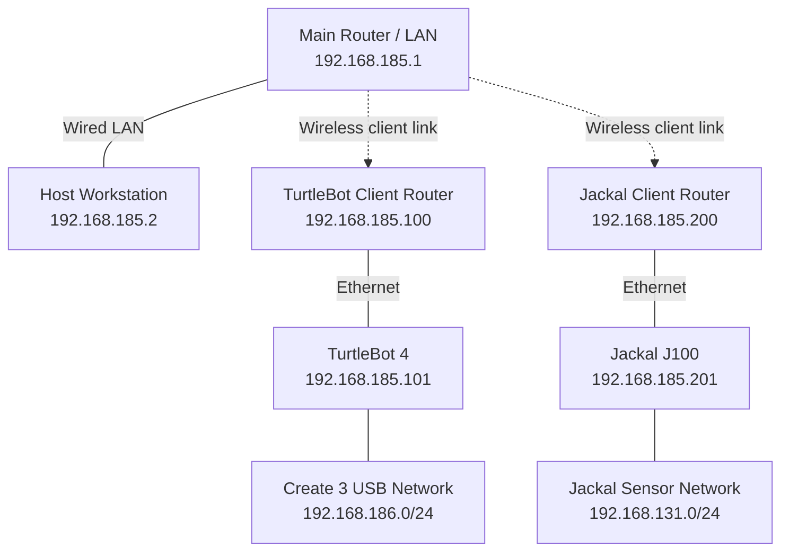

# Jackal & TurtleBot Platform

Documentation for a ROS 2 platform connecting a **Clearpath Jackal J100**, a **TurtleBot 4**, and an **Alienware host workstation**. The robots share a Fast DDS network so the host can monitor sensor data, visualize robot state, and record experiments.

The documented setup uses **Ubuntu 24.04**, **ROS 2 Jazzy**, and **Fast DDS** (`rmw_fastrtps_cpp`). The network baseline was recorded on **October 9, 2026**; Jackal operating instructions and troubleshooting updates extend through **October 13, 2026**.

This repository contains operating instructions, network records, and a proposed Jackal Nav2 tuning configuration. The deployed custom launch files, robot configuration files, and ROS packages referenced in the guides reside on the devices.

## Documentation

| Guide | Contents |
| --- | --- |
| [Jackal Navigation Run Analysis](analysis/jackal_20261013_103510/REPORT.md) | October 13 bag analysis: prolonged MPPI stalls, normal-tracking reverse commands, progress failures, verified indoor settings, and proposed comparison tests. |
| [Jackal Debug Recording](Docs/Jackal_Debug_Recording_2026-10-13.md) | Host debug bags with live parameter snapshots, navigation topics, and onboard SLAM / Nav2 log capture. |
| [Jackal Quick Start](Docs/Jackal_Quick_Start_2026-10-13.md) | Concise operating commands: choose a new-map starting pose, start SLAM and indoor Nav2, open Host RViz, record with Space, save, and exit; includes one-time deployment. |
| [Jackal Startup and Recording Manual](Docs/Jackal_Startup_SLAM_Nav2_RViz_Rosbag_Manual_2026-10-12.md) | Step-by-step workflow: reset or choose a map starting pose, onboard SLAM and low-speed Nav2, Host RViz, Space-controlled rosbag recording, map saving, and lifecycle timeout recovery. |
| [Robot and Host Command Manual](Docs/ROS2_Jackal_TurtleBot_Host_CMD_Manual_2026-10-09.md) | Commands for each device, Jackal SLAM and low-speed Nav2, visualization, data recording, startup/shutdown, and troubleshooting. |
| [Network Topology and Configuration](Docs/ROS2_Multi_Robot_Network_Topology_2026-10-09.md) | Router layout, IP addresses, Fast DDS profiles, persistent network configuration, and recorded communication checks. |

All project documentation is written in English. For everyday operation, use the [current RPP operating manual](Docs/Jackal_RPP_Trial_2026-10-14.md), including the specified start pose, SLAM, RPP Nav2, Host RViz, onboard recording, and transfer to the Host. Use the topology guide for the updated router arrangement; earlier manuals retain historical configurations and tuning procedures.

## Platform Overview

| Device | Role | Main hardware / software |
| --- | --- | --- |
| **Host workstation** | SSH access, network diagnostics, ROS topic monitoring, RViz, and ROS bag recording | Alienware workstation with ROS 2 Jazzy |
| **TurtleBot 4** | Mobile base operation and sensor publishing | Raspberry Pi, Create 3 base, RPLIDAR, and OAK-D camera |
| **Jackal J100** | Mobile base operation, sensor publishing, onboard SLAM, and navigation | Clearpath platform, Ouster OS1 LiDAR, RealSense D435, SLAM Toolbox, and Nav2 with MPPI |

In the current operating setup, **SLAM and Nav2 run on Jackal**. The host provides visualization and monitoring; launching a second navigation stack in the same namespace would conflict with the onboard stack.

## Network Layout

The shared ROS network is `192.168.185.0/24`. Each robot connects by Ethernet to a router in client mode, which provides a wireless link to the main router.



| Endpoint | Interface / mode | Address |
| --- | --- | --- |
| Host workstation | `enp132s0` | `192.168.185.2/24` |
| TurtleBot 4 Raspberry Pi | `eth0` | `192.168.185.101/24` |
| Jackal onboard computer | `br0` | `192.168.185.201/24` |
| Main router | LAN / gateway | `192.168.185.1` |
| TurtleBot client router | Client mode | `192.168.185.100` |
| Jackal client router | Client mode | `192.168.185.200` |
| TurtleBot internal USB connection | `usb0` on Raspberry Pi | `192.168.186.3/24` |
| Jackal internal sensor connection | Additional address on `br0` | `192.168.131.1/24` |

The internal robot subnets remain separate from the shared ROS subnet. The NETGEAR GS108Tv3 switch is not part of the recorded setup. DDS communication has been observed across the client links; router multicast forwarding and link stability should be rechecked after network changes.

## ROS 2 Communication

The devices share `ROS_DOMAIN_ID=0` and use `rmw_fastrtps_cpp`. The documented discovery setting is `SUBNET`.

| Data / interface | TurtleBot 4 | Jackal J100 |
| --- | --- | --- |
| Odometry | `/odom` | `/j100_0949/platform/odom` |
| 2D laser scan | `/scan` | `/j100_0949/sensors/lidar3d_0/scan` |
| Velocity command | `/cmd_vel` | `/j100_0949/cmd_vel` |
| Transforms | `/tf`, `/tf_static` | `/j100_0949/tf`, `/j100_0949/tf_static` |
| RGB image | `/oakd/rgb/preview/image_raw` | `/j100_0949/sensors/camera_0/color/image` |
| SLAM map | Depends on the active TurtleBot SLAM setup | `/j100_0949/map` when SLAM is running |

Topic namespaces distinguish the robot interfaces, but frame IDs such as `odom` and `base_link` can still overlap. Configure RViz subscriptions and TF remapping for the robot being viewed. Camera and map topics depend on the corresponding drivers or applications being active.

## Host Quick Start

These checks assume ROS 2 Jazzy and the Fast DDS RMW package are already installed, the host has its documented LAN address, and both robots are running their platform services. Cloning this repository does not configure the devices.

In a host terminal, load the ROS environment:

```bash
source /opt/ros/jazzy/setup.bash
export ROS_DOMAIN_ID=0
export RMW_IMPLEMENTATION=rmw_fastrtps_cpp
export ROS_AUTOMATIC_DISCOVERY_RANGE=SUBNET
export ROS_LOCALHOST_ONLY=0
```

Check connectivity and ROS discovery:

```bash
ip -br -4 addr
ping -c 3 -W 1 192.168.185.101
ping -c 3 -W 1 192.168.185.201

ros2 topic list -t
ros2 topic info -v /odom
ros2 topic info -v /j100_0949/platform/odom
```

Check actual data delivery by running these commands one at a time. Press `Ctrl+C` to stop each measurement:

```bash
ros2 topic hz /odom
ros2 topic hz /scan
ros2 topic hz /j100_0949/platform/odom
```

For device-specific commands, connect from separate host terminals:

```bash
ssh ubuntu@192.168.185.101  # TurtleBot 4
ssh robot@192.168.185.201   # Jackal J100
```

Follow the [command manual](Docs/ROS2_Jackal_TurtleBot_Host_CMD_Manual_2026-10-09.md) for robot startup, SLAM, navigation, RViz, and recording procedures.

## Jackal Runtime Configuration

The operating setup uses a custom low-speed Nav2 launch file on Jackal:

| File on Jackal | Purpose |
| --- | --- |
| `/etc/clearpath/robot.yaml` | Robot configuration and base velocity limits |
| `/home/robot/jackal_nav2/nav2_low_speed.launch.py` | Custom Nav2 launch entry point |
| `/home/robot/jackal_nav2/nav2_low_speed.yaml` | MPPI and velocity smoother parameters |
| `/home/robot/fastdds_185.xml` | Fast DDS profile selecting the shared LAN interface |

The recorded velocity limits are **0.3 m/s forward**, **0.2 m/s reverse**, and **0.6 rad/s angular speed**. These are the lab's configured software limits. The command manual includes runtime parameter checks and the motion-control chain.

Use the custom launch file for the documented configuration and run only one instance of each SLAM/Nav2 stack. Clearpath platform services start at boot; the custom SLAM and Nav2 processes are currently launched manually.

The [Nav2 tuning candidate](config/jackal/nav2_low_speed.yaml), prepared on October 12 from the operator's pasted configuration, lowers navigation turning speed to **0.2 rad/s**, sets normal linear/angular deceleration limits to **0.3 m/s² / 0.3 rad/s²**, and interpolates commands at **50 Hz**. It also includes custom single-goal and multi-goal behavior trees limiting recovery backup to **0.05 m/s** and recovery spin to **0.15 rad/s**, with longer action time allowances. The operator previously confirmed the **0.3 rad/s** turning limit, controller/smoother deceleration, smoothing frequency, recovery spin limit, and single-goal behavior-tree path. That earlier adjustment reduced only the normal navigation angular limit to **0.2 rad/s** in MPPI and both directions in the velocity smoother; acceleration and recovery settings are unchanged. The operator subsequently reported using **0.2 rad/s** with continued oscillation; the full active configuration has not been read back. Section **4.4** of the [startup manual](Docs/Jackal_Startup_SLAM_Nav2_RViz_Rosbag_Manual_2026-10-12.md#44-first-compare-a-lower-turning-speed) provides temporary runtime commands. Maintain one active YAML named `nav2_low_speed.yaml`; it contains the original configuration plus all tuning changes. Back up the robot configuration before uploading this YAML and its `behavior_trees/` directory together. See sections **J-5a/J-5b** of the [command manual](Docs/ROS2_Jackal_TurtleBot_Host_CMD_Manual_2026-10-09.md) for changes, installation, runtime checks, and rollback. The base controller's recorded limits above remain the deployed baseline. Section **J-3a** documents restarting mapping from the current pose, with an odometry-zero check before starting SLAM; the operator has confirmed near-zero odometry and TF after the documented reset procedure.

A separate [indoor low-speed MPPI candidate](config/jackal/nav2_low_speed_indoor.yaml) addresses the subsequent report that oscillation continued at **0.2 rad/s**. It limits forward/reverse speed to **0.2 / 0.1 m/s**, uses a **4 s** prediction horizon with reduced sampling noise, lowers the path-alignment activation gate, and sets progress checking to **0.2 m / 30 s**. Its two independently named `*_indoor_recovery.xml` files request **30° spins** and **0.15 m backups at 0.05 m/s** per recovery; reverse and repeated recoveries remain possible. This candidate passed offline XML/limit checks and ROS 2 parsing of **275 parameters**. The operator confirmed a **0.52 × 0.44 m footprint** centered on `base_link`, plus **0.02 m padding per side** (a **0.56 × 0.48 m** padded rectangle). Both costmaps now use this geometry and **0.6 m inflation**, retaining a cost scaling factor of **4.0**. The October 13 recording's runtime snapshot confirms these indoor settings were active, but the trial showed prolonged stalls and reversing; see the [run analysis](analysis/jackal_20261013_103510/REPORT.md). The new recommendations in that report have not been deployed. Section **4.5** of the [startup manual](Docs/Jackal_Startup_SLAM_Nav2_RViz_Rosbag_Manual_2026-10-12.md#45-new-indoor-low-speed-mppi-candidate) covers upload, backup, activation using the existing launch, runtime checks, and rollback.

A [Plan B candidate](config/jackal/nav2_low_speed_indoor_plan_b.yaml) wraps the indoor MPPI controller in Rotation Shim: align above roughly **20°**, hand back below roughly **10°**, and rotate at **0.15 rad/s** with **0.3 rad/s²** acceleration. It also handles final goal heading. Reverse limits, progress checking, footprint, inflation, and recovery remain at the indoor baseline. The candidate passed ROS parameter parsing and an isolated configure/cleanup check using the real Nav2 1.3.12 Shim and MPPI plugins. The subsequent Jackal trial confirmed deployment but showed repeated left-right heading swings; see the [Plan B run analysis](analysis/jackal_20261013_114556/REPORT.md). A separate [heading-cost comparison candidate](config/jackal/nav2_low_speed_indoor_plan_b_heading.yaml) changes only the MPPI PathAngleCritic activation threshold from 0.35 to 0.10 rad; the [next recorded trial](analysis/jackal_20261013_120526/REPORT.md) confirmed that value but still showed turn oscillation despite a successful straight goal. A separate [slower Shim comparison](config/jackal/nav2_low_speed_indoor_plan_b_slow_shim.yaml) now changes only Shim target angular speed from 0.15 to 0.10 rad/s relative to that heading candidate; the [122553 run](analysis/jackal_20261013_122553/REPORT.md) confirmed it but still showed oscillation. The latest [indoor turn-control candidate](config/jackal/nav2_low_speed_indoor_turn_control.yaml) lowers MPPI yaw speed to 0.08 rad/s and smoother yaw bounds to ±0.10 rad/s, and switches to PoseProgressChecker (0.20 m OR 0.35 rad within 30 s). Real plugin configuration/readback passed locally. The [124612 trial](analysis/jackal_20261013_124612/REPORT.md) confirmed deployment: progress failures disappeared, but heading oscillation persisted and wheel feedback showed the inside wheels nearly stationary during tight low-speed turns. The recorder now also captures motor setpoints/feedback and base-controller parameters for diagnosis. Rotation progress also accepts oscillation, so fewer recoveries alone are not a success criterion. Use [the new deployment procedure](Docs/Jackal_Quick_Start_2026-10-13.md#9-reduce-mppi-angular-speed-and-include-rotation-in-progress-checking). See [Plan B deployment and rollback](Docs/Jackal_Quick_Start_2026-10-13.md#8-plan-b-add-rotation-shim).

The [Ouster configuration script](scripts/configure_jackal_lidar.py) selects **ring 15** on `j100-0949`, measured at **+0.32°** on its OS-1-32-U1-SR. Ring 15 has been confirmed in the running driver. By default the script changes only `scan_ring`. The optional `--fix-scan-frame` mode separates the lidar and sensor frames and enables the driver's calibration-derived TF; it preserves the point-cloud reference and all mounting `xyz/rpy` values. This addresses the measured 180° discrepancy between the raw scan and point cloud, after the operator confirmed that the point cloud matches physical directions. The frame correction has passed offline preservation checks and the installed Clearpath parser; robot deployment remains pending. Both modes support a read-only preview and `--apply`, which backs up `/etc/clearpath/robot.yaml` before rewriting its YAML formatting/comments. Stop Nav2/SLAM and park the robot before applying. See **J-2a** in the [command manual](Docs/ROS2_Jackal_TurtleBot_Host_CMD_Manual_2026-10-09.md) for deployment and verification.

To start a fresh map with a chosen initial pose without restarting the base service, use [start_jackal_slam_at_pose.py](scripts/start_jackal_slam_at_pose.py), for example `--x 1 --y 0 --yaw-deg 0`. It reads the current TF, adds a session reference frame, and starts SLAM while preserving base odometry. The revised script checks lifecycle state after service timeouts and reports `SLAM ACTIVE` only after activation is confirmed. See section 9 of the [startup manual](Docs/Jackal_Startup_SLAM_Nav2_RViz_Rosbag_Manual_2026-10-12.md) for upload, startup, TF checks, and recovery. The previous version stalled during configuration on Jackal. The revision passed 10 regression checks and an isolated local SLAM test, including clean shutdown; upload and robot verification of this revision are still pending.

For manual Host recording, run `bash scripts/record_jackal.sh`: its default is now the 21-topic GLIM + camera list (the original 14 topics plus 7 camera topics), including LiDAR, RGB/depth images, calibration, IMU, odometry, wheel joint states, TF, map, and pose. See the [current operation manual](Docs/Jackal_RPP_Trial_2026-10-14.md) for SLAM, RPP navigation, RViz, and the recording command. The [recorder](scripts/record_jackal.sh) writes MCAP bags under `~/Desktop/jackal_rosbag_repo/recording/`, with 2 GiB file splitting and [QoS overrides](config/jackal/rosbag_qos.yaml) for latched data. The script initially waits for Space before creating the recorder, preserving one-shot static TF and calibration. Once recording begins, Space toggles pause/resume and Ctrl+C stops and saves the bag. Inspect the bag message counts after stopping. Recording has not been started by the assistant. See **H-6a** in the command manual for details.

## Recorded Validation and Open Items

The guides record successful cross-device discovery, data transfer, and persistent robot IP addresses after reboot. Example rates observed at the host were:

| Stream | Recorded rate |
| --- | --- |
| TurtleBot odometry | Approximately 20 Hz |
| TurtleBot laser scan | Approximately 8.1 Hz |
| Jackal odometry | Approximately 50 Hz |
| Jackal RGB image | Approximately 29.6 FPS |
| Jackal depth image | Approximately 14–15 FPS |

These are historical observations, not guaranteed rates. Topic discovery alone does not confirm that a sensor is publishing data.

Open items in the records include longer-term client-link stability, further SLAM/navigation trials, confirmation of the host's persistent Ethernet configuration, and an NVIDIA driver/library mismatch that affected RViz on the host. Refer to the guides for the distinction between verified behavior and pending checks.
