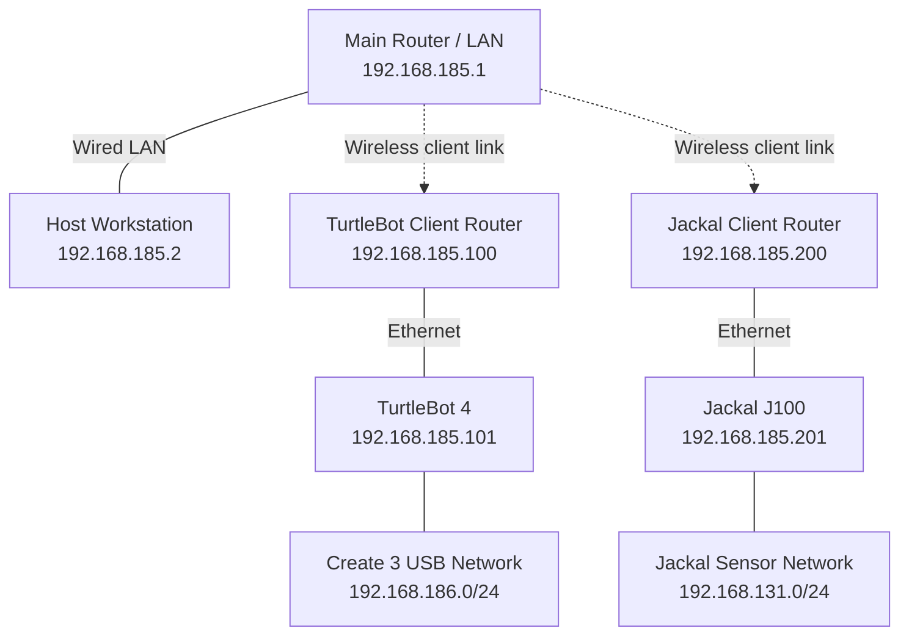

# Jackal & TurtleBot Platform

Documentation for a ROS 2 platform connecting a **Clearpath Jackal J100**, a **TurtleBot 4**, and an **Alienware host workstation**. The robots share a Fast DDS network so the host can monitor sensor data, visualize robot state, and record experiments.

The documented setup uses **Ubuntu 24.04**, **ROS 2 Jazzy**, and **Fast DDS** (`rmw_fastrtps_cpp`). Configuration details and observations reflect the lab setup recorded on **October 9, 2026**.

This repository currently contains operating instructions and network records. Custom launch files, robot configuration files, and ROS packages referenced in the guides reside on the devices and are not included here.

## Documentation

| Guide | Contents |
| --- | --- |
| [Robot and Host Command Manual](Docs/ROS2_Jackal_TurtleBot_Host_CMD_Manual_2026-10-09.md) | Commands for each device, Jackal SLAM and low-speed Nav2, visualization, data recording, startup/shutdown, and troubleshooting. |
| [Network Topology and Configuration](Docs/ROS2_Multi_Robot_Network_Topology_2026-10-09.md) | Router layout, IP addresses, Fast DDS profiles, persistent network configuration, and recorded communication checks. |

The detailed guides are primarily written in Chinese. Use the topology guide for the updated router arrangement and the command manual for the current placement of SLAM and Nav2 on Jackal.

## Platform Overview

| Device | Role | Main hardware / software |
| --- | --- | --- |
| **Host workstation** | SSH access, network diagnostics, ROS topic monitoring, RViz, and ROS bag recording | Alienware workstation with ROS 2 Jazzy |
| **TurtleBot 4** | Mobile base operation and sensor publishing | Raspberry Pi, Create 3 base, RPLIDAR, and OAK-D camera |
| **Jackal J100** | Mobile base operation, sensor publishing, onboard SLAM, and navigation | Clearpath platform, Ouster OS1 LiDAR, RealSense D435, SLAM Toolbox, and Nav2 with MPPI |

In the current operating setup, **SLAM and Nav2 run on Jackal**. The host provides visualization and monitoring; launching a second navigation stack in the same namespace would conflict with the onboard stack.

## Network Layout

The shared ROS network is `192.168.185.0/24`. Each robot connects by Ethernet to a router in client mode, which provides a wireless link to the main router.



| Endpoint | Interface / mode | Address |
| --- | --- | --- |
| Host workstation | `enp132s0` | `192.168.185.2/24` |
| TurtleBot 4 Raspberry Pi | `eth0` | `192.168.185.101/24` |
| Jackal onboard computer | `br0` | `192.168.185.201/24` |
| Main router | LAN / gateway | `192.168.185.1` |
| TurtleBot client router | Client mode | `192.168.185.100` |
| Jackal client router | Client mode | `192.168.185.200` |
| TurtleBot internal USB connection | `usb0` on Raspberry Pi | `192.168.186.3/24` |
| Jackal internal sensor connection | Additional address on `br0` | `192.168.131.1/24` |

The internal robot subnets remain separate from the shared ROS subnet. The NETGEAR GS108Tv3 switch is not part of the recorded setup. DDS communication has been observed across the client links; router multicast forwarding and link stability should be rechecked after network changes.

## ROS 2 Communication

The devices share `ROS_DOMAIN_ID=0` and use `rmw_fastrtps_cpp`. The documented discovery setting is `SUBNET`.

| Data / interface | TurtleBot 4 | Jackal J100 |
| --- | --- | --- |
| Odometry | `/odom` | `/j100_0949/platform/odom` |
| 2D laser scan | `/scan` | `/j100_0949/sensors/lidar3d_0/scan` |
| Velocity command | `/cmd_vel` | `/j100_0949/cmd_vel` |
| Transforms | `/tf`, `/tf_static` | `/j100_0949/tf`, `/j100_0949/tf_static` |
| RGB image | `/oakd/rgb/preview/image_raw` | `/j100_0949/sensors/camera_0/color/image` |
| SLAM map | Depends on the active TurtleBot SLAM setup | `/j100_0949/map` when SLAM is running |

Topic namespaces distinguish the robot interfaces, but frame IDs such as `odom` and `base_link` can still overlap. Configure RViz subscriptions and TF remapping for the robot being viewed. Camera and map topics depend on the corresponding drivers or applications being active.

## Host Quick Start

These checks assume ROS 2 Jazzy and the Fast DDS RMW package are already installed, the host has its documented LAN address, and both robots are running their platform services. Cloning this repository does not configure the devices.

In a host terminal, load the ROS environment:

```bash
source /opt/ros/jazzy/setup.bash
export ROS_DOMAIN_ID=0
export RMW_IMPLEMENTATION=rmw_fastrtps_cpp
export ROS_AUTOMATIC_DISCOVERY_RANGE=SUBNET
export ROS_LOCALHOST_ONLY=0
```

Check connectivity and ROS discovery:

```bash
ip -br -4 addr
ping -c 3 -W 1 192.168.185.101
ping -c 3 -W 1 192.168.185.201

ros2 topic list -t
ros2 topic info -v /odom
ros2 topic info -v /j100_0949/platform/odom
```

Check actual data delivery by running these commands one at a time. Press `Ctrl+C` to stop each measurement:

```bash
ros2 topic hz /odom
ros2 topic hz /scan
ros2 topic hz /j100_0949/platform/odom
```

For device-specific commands, connect from separate host terminals:

```bash
ssh ubuntu@192.168.185.101  # TurtleBot 4
ssh robot@192.168.185.201   # Jackal J100
```

Follow the [command manual](Docs/ROS2_Jackal_TurtleBot_Host_CMD_Manual_2026-10-09.md) for robot startup, SLAM, navigation, RViz, and recording procedures.

## Jackal Runtime Configuration

The operating setup uses a custom low-speed Nav2 launch file on Jackal:

| File on Jackal | Purpose |
| --- | --- |
| `/etc/clearpath/robot.yaml` | Robot configuration and base velocity limits |
| `/home/robot/jackal_nav2/nav2_low_speed.launch.py` | Custom Nav2 launch entry point |
| `/home/robot/jackal_nav2/nav2_low_speed.yaml` | MPPI and velocity smoother parameters |
| `/home/robot/fastdds_185.xml` | Fast DDS profile selecting the shared LAN interface |

The recorded velocity limits are **0.3 m/s forward**, **0.2 m/s reverse**, and **0.6 rad/s angular speed**. These are the lab's configured software limits. The command manual includes runtime parameter checks and the motion-control chain.

Use the custom launch file for the documented configuration and run only one instance of each SLAM/Nav2 stack. Clearpath platform services start at boot; the custom SLAM and Nav2 processes are currently launched manually.

## Recorded Validation and Open Items

The guides record successful cross-device discovery, data transfer, and persistent robot IP addresses after reboot. Example rates observed at the host were:

| Stream | Recorded rate |
| --- | --- |
| TurtleBot odometry | Approximately 20 Hz |
| TurtleBot laser scan | Approximately 8.1 Hz |
| Jackal odometry | Approximately 50 Hz |
| Jackal RGB image | Approximately 29.6 FPS |
| Jackal depth image | Approximately 14–15 FPS |

These are historical observations, not guaranteed rates. Topic discovery alone does not confirm that a sensor is publishing data.

Open items in the records include longer-term client-link stability, further SLAM/navigation trials, confirmation of the host's persistent Ethernet configuration, and an NVIDIA driver/library mismatch that affected RViz on the host. Refer to the guides for the distinction between verified behavior and pending checks.
