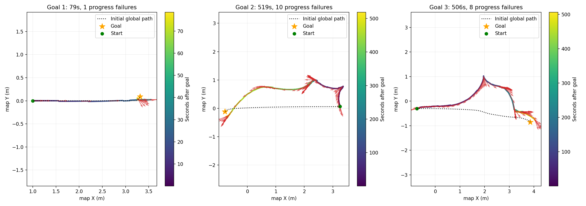
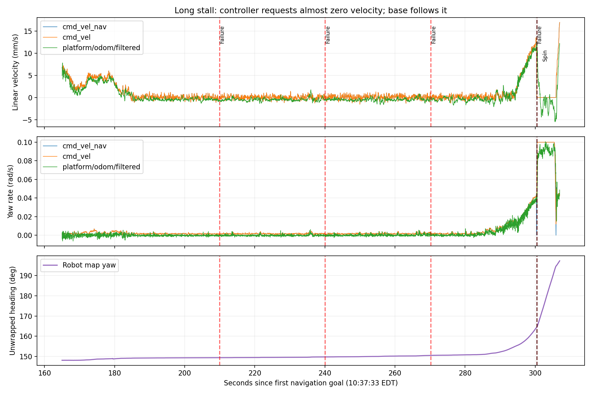
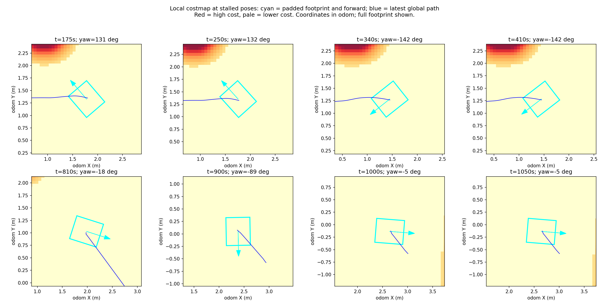

# Jackal Indoor Navigation Analysis

The main anomalies were prolonged near-zero MPPI output during path tracking and extensive commanded reversing. Chassis odometry broadly followed issued commands; the data does not support "angular limit too high and chassis unable to brake" as the primary explanation. Next, prioritize heading alignment and forward-motion policy.

Data: `~/Desktop/jackal_rosbag_repo/debug/jackal_20261013_103510/`, containing the bag, initial runtime snapshots, and robot Nav2/SLAM logs. Recording lasted approximately 19 minutes 39 seconds with 993,617 messages. Event times below are US Eastern time on October 13, 2026, aligned using robot message timestamps and logs.

**All three goals eventually returned `Goal succeeded`, but each of the last two took over 8 minutes, with 19 intermediate progress failures in total. Action success does not establish acceptable tracking performance.** This was offline analysis only; no parameters were deployed and no robot motion was started.

## Performance by goal

| Goal | Start–end | Duration | Progress failures | Nearly stationary time | Final position error | Final heading error |
| --- | --- | --- | --- | --- | --- | --- |
| 1 | 10:37:33–10:38:52 | 79 s | 1 | Approximately 14 s, 18% | Approximately 6 cm | Approximately 14.2° |
| 2 | 10:39:01–10:47:40 | 8 min 39 s | 10 | Approximately 301 s, 58% | Approximately 18 cm | Approximately 14.2° |
| 3 | 10:48:10–10:56:36 | 8 min 26 s | 8 | Approximately 282 s, 56% | Approximately 21 cm | Approximately 14.2° |

"Nearly stationary" means filtered odometry simultaneously has `|vx| < 0.01 m/s` and `|wz| < 0.02 rad/s`, with duration estimated from approximately 50 Hz samples. Errors compare the last navigation feedback before completion with the path endpoint. They are map-frame estimate errors, not externally measured physical errors. Current success tolerances are `xy_goal_tolerance: 0.25 m` and `yaw_goal_tolerance: 0.25 rad` (approximately 14.3°), so these outcomes meet the configured criteria.

Black dashed lines show each goal's first global path; colored points show the map-frame robot trajectory, colored by time; red arrows show heading. The latter two runs show detours and heading mismatch. Maximum deviations from initial paths were approximately 0.94 m and 1.42 m. Replanning and SLAM corrections occur during motion, so these describe trajectory differences rather than tracking error against the current path.

## Stalling begins at the controller output

Goal 2 stalled for a long time near `(2.44, 0.98)` m and approximately 150° heading, while feedback still reported approximately 3.45 m remaining. In the 20-second windows before progress failures at 10:41:03, 10:41:33, and 10:42:03:

| Metric | Typical value |
| --- | --- |
| Median absolute MPPI linear output | Approximately **0.00030 m/s**, or 0.3 mm/s |
| Median absolute MPPI angular output | Approximately **0.0016 rad/s**, or 0.09°/s |
| Odometry | Also nearly stationary |

The controller itself was not requesting meaningful translation or rotation during these stalls. Further reducing the 0.2 m progress radius cannot automatically turn near-zero commands into effective tracking.

Linear velocity is shown in mm/s. Red dashed lines mark progress failures; black dashed lines mark Spin recovery starts. Heading is unwrapped to avoid interpreting ±180° representation changes as sudden rotation. Recovery spin starts near 300 seconds, after which motion changes substantially.

The evidence places the problem at the control-decision/input layer. An unfavorable MPPI solution or poor tradeoffs between path and final-heading costs remain hypotheses. No candidate trajectories or critic scores were recorded, so no single weight can be established as the sole cause.

## Most reversing occurs during normal path tracking

Using final chassis command `vx < -0.01 m/s` to define reversing, aligned at 50 Hz:

| Reversing statistic | Duration |
| --- | --- |
| All reverse commands | Approximately 155 s |
| During the two BackUp recoveries, including short output tails | Approximately 7 s |
| Outside BackUp | Approximately 148 s |
| First 100 seconds after goal 3 starts | Approximately 92 s reversing |

Negative velocities outside BackUp agree with navigation commands and mostly occur during FollowPath. `FollowPath.vx_min: -0.1` permits MPPI reversing, and `PreferForwardCritic` is a preference rather than a hard prohibition. Reducing BT backup distance alone cannot remove these 148 seconds. [Nav2 Jazzy MPPI parameters and algorithm](https://github.com/ros-navigation/navigation2/blob/jazzy/nav2_mppi_controller/README.md)

Both recorded recovery Spin requests were approximately 0.52 rad, with map heading changes of approximately 30°. The new **30° recovery angle was active**. Subsequent FollowPath can keep turning; total rotation is not bounded by one recovery action's angle.

## Evidence on speed limits and collision checks

| Check | Observation | Interpretation |
| --- | --- | --- |
| Peak angular command | Approximately 0.106 rad/s | Well below the 0.2 rad/s limit; further limiting is not the first priority |
| Peak raw-odometry angular speed | Approximately 0.109 rad/s | No sustained rotation far above commands |
| Body IMU Z angular velocity | Absolute peak approximately 0.106 rad/s; correlation with odometry on turning samples approximately 0.998 | Gyroscope data also shows no large uncontrolled rotation; this is not external pose-accuracy validation |
| Smoother vs final navigation output | Mean absolute differences approximately 0.00025 m/s and 0.00028 rad/s | Repeated collision-driven truncation of large commands is not evident as the main stall cause |
| Chassis command vs raw odometry | Mean absolute differences approximately 0.00060 m/s and 0.00153 rad/s | Execution broadly follows commands; this is not external motion-accuracy validation |
| Navigation command period | Median approximately 50 ms, 99th percentile approximately 64 ms | Mostly near 20 Hz; isolated overruns do not imply persistently low-rate control |
| Local costmaps at 8 stalled positions | All sampled footprint costs were 0 | Sampled positions did not show the footprint inside mapped obstacles |

Cyan rectangles are padded footprints; arrows point forward; blue lines are the latest global paths in `odom`. Across 8 snapshots, the distance from body center to the nearest lethal-cell center was approximately 1.4–2.0 m. This reflects recorded costmaps only, not physical clearance, and cannot exclude obstacles missing from sensors/maps.

**These data provide no basis for further reducing footprint or inflation.** Retain confirmed body dimensions and padding. The collision-state topic had no recorded messages, which alone does not prove Collision Monitor was disabled; the assessment uses actual velocity-chain data and costmaps.

## Final-heading adjustment conflicts with progress checking

Goal 1 was `(3.31, 0.09, -86.8°)` and goal 3 `(3.85, -0.85, -88.4°)`. Both mainly traveled east in the map but requested a nearly south-facing final heading, requiring extra turning near the destination. The goal arrow dragged in RViz controls this requirement.

At goal 1's 10:38:46 progress failure, the robot was approximately 9 cm from the target, with heading approximately −54.9° rather than requested −86.8°. Turning commands of approximately 0.035 rad/s were still present beforehand. Current `SimpleProgressChecker` uses a `0.2 m / 30 s` displacement criterion; in-place rotation cannot reset its position reference, allowing slow heading adjustment to trigger recovery.

Test `nav2_controller::PoseProgressChecker`, which resets progress after sufficient displacement **or** angular change. It addresses valid rotation being classified as no progress, but does not fix the several-minute near-zero stalls above. [Nav2 Jazzy PoseProgressChecker implementation](https://github.com/ros-navigation/navigation2/blob/jazzy/nav2_controller/plugins/pose_progress_checker.cpp)

## Configuration actually loaded

Initial snapshots confirm the new indoor settings were active, rather than only present in a local candidate.

| Item | Recorded value |
| --- | --- |
| Global planner / local controller | NavFn / MPPI DiffDrive |
| MPPI velocity range | `vx_max: 0.2`, `vx_min: -0.1`, `wz_max: 0.2` |
| MPPI acceleration/deceleration | `ax_max: 0.3`, `ax_min: -0.3`, `az_max: 0.3` |
| Prediction and sampling | `80 × 0.05 s = 4 s`, `batch_size: 1500`, `vx_std/wz_std: 0.1/0.1` |
| Smoother | 50 Hz, OPEN_LOOP, linear −0.1 to 0.2 m/s, angular ±0.2 rad/s |
| Progress check | SimpleProgressChecker, 0.2 m / 30 s |
| Footprint / padding | 0.26 m forward/backward, 0.22 m left/right; additional 0.02 m per side |
| Inflation | Local/global both 0.6 m, scaling factor 4.0 |
| Recovery tree | Indoor; spin 30°, backup 0.15 m at 0.05 m/s |

Controller `odom_topic: odom` is explicitly remapped by the custom launch to `/j100_0949/platform/odom`; its short name does not imply missing odometry input.

## Order of changes for the next run

1. **Establish repeatable goals first.** On a known straight segment with adequate space, place a goal approximately 2 m ahead with its arrow along travel. Separately test initial heading differences of 90° and 180°, then final-heading adjustment. Retain the same limits and record each run.
2. **Prioritize Rotation Shim with MPPI.** Align in place for a substantially misaligned path, then hand tracking to MPPI; `rotate_to_goal_heading: true` can separately handle final orientation. NavFn/MPPI are supported, but this bag cannot guarantee eliminating all mid-path stalls. [Nav2 Jazzy Rotation Shim](https://github.com/ros-navigation/navigation2/blob/jazzy/nav2_rotation_shim_controller/README.md)
3. **Compare prohibiting reverse during normal tracking separately.** Test MPPI `vx_min` at `0.0`, retaining negative-speed capability in the smoother and behavior server for recovery. Otherwise BackUp is also blocked, causing new recovery failures. Changing `vx_min` alone does not guarantee large-angle alignment; assess alongside step 2. [MPPI velocity constraints](https://github.com/ros-navigation/navigation2/blob/jazzy/nav2_mppi_controller/README.md)
4. **Count valid in-place rotation as progress.** Compare PoseProgressChecker, for example retaining 0.2 m / 30 s and trying `required_movement_angle: 0.3 rad`. This is a trial value requiring checks against rotational noise and actual motion. Do not conceal near-zero stalls with indefinitely longer timeouts. [PoseProgressChecker criteria](https://github.com/ros-navigation/navigation2/blob/jazzy/nav2_controller/plugins/pose_progress_checker.cpp)
5. **If near-zero output persists, collect MPPI evidence and tune it.** For a short reproduction, record candidate/optimal trajectories and version-supported score diagnostics. Inspect angular sampling and PathAlign/PathAngle/GoalAngle before changing one item at a time. RPP can also serve as a controller comparison; do not change all weights, braking limits, and inflation together.

Compare completion time, FollowPath reverse duration, idle time outside useful motion, progress failures, and final pose for the same goal. Aim for no progress failures or normal-tracking reversing in the first simple straight test, with continuous final-heading adjustment. Current 25 cm and approximately 14.3° success tolerances are fairly broad; tighten them to task requirements after tracking stabilizes. Tightening alone cannot resolve current stalls.

## Localization and data limitations

Around 10:39:07, `map → odom_start` corrected by approximately 0.386 m and 6.2°, showing SLAM can shift the navigation reference. This may affect path stability and warrants comparison with fixed-map localization, but cannot alone explain several minutes of near-zero controller output.

Host receipt and robot message times share an approximately 1.76-second offset, possibly including clock difference; it must not be treated directly as control latency. Velocity-chain statistics align Host receipts after subtracting the common offset; event/pose analysis prioritizes message stamps and robot logs. The recorder reported 131 transport losses, so this is not lossless data.

`params_after` is incomplete because Nav2/SLAM exited before recording stopped. This report uses `params_before` and startup configuration logs and cannot guarantee no unrecorded parameter changes occurred. Full clouds, cameras, and MPPI candidate trajectories are absent from the usable data, preventing complete perception validation or isolation of a single critic problem.

## Analysis files

- [Per-goal statistics](goal_summary.csv)
- [State and velocity near 19 progress failures](progress_failures.csv)
- [Goal and stall statistics JSON](summary.json)
- [Reverse duration and velocity-chain statistics JSON](diagnostics.json)
- [Full-session velocity and remaining-distance curves](motion_overview.png)

Original bags and robot logs remain unchanged.
