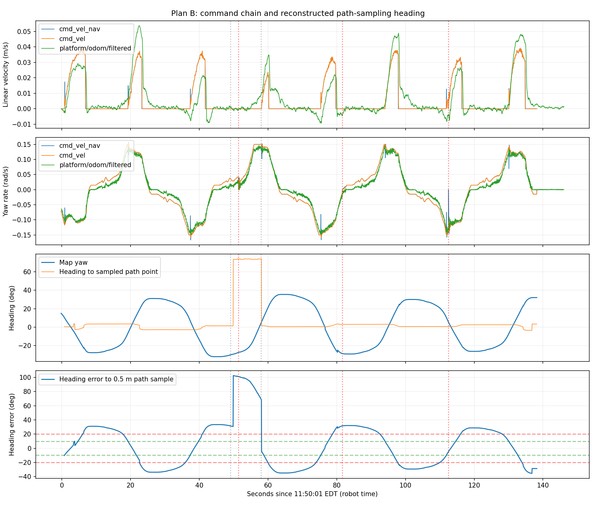

# Jackal Plan B: Oscillation on a Straight Path

Plan B was loaded but did not deliver stable tracking. Heading oscillated continuously on a straight segment, consistent with **Shim alignment → handoff to MPPI → MPPI keeps turning in the same direction past path heading → a later replan triggers reverse Shim alignment**. Commands repeat this cycle; chassis inability to stop after a stop command is not the main explanation.

Data directory: `~/Desktop/jackal_rosbag_repo/debug/jackal_20261013_114556/`. The bag spans approximately 146.6 s with 109,215 messages. Valid navigation commands cover approximately 138 s, 11:50:01–11:52:19 EDT on October 13, 2026, by robot time. Recording began after navigation started; earlier motion has logs only, so the bag cannot assess the entire launch session.

## Observed behavior

| Item | Recorded result |
| --- | --- |
| Body heading in map | −31.9° to +35.4° |
| Full left-right oscillation period | Approximately 36–38 s |
| Position change | Approximately `(1.63, −0.00)` to `(2.41, −0.03)` m |
| Peak forward command | Approximately 0.040 m/s |
| Fraction with zero linear command | Approximately 76% |
| Progress failures | 3 within bag coverage |
| Reverse commands | None within bag coverage |
| Recovery Spin / BackUp | None executed within bag coverage |

Earlier logs contain NavFn planning failures and Spin/BackUp around 11:48, before the bag. They cannot explain periodic oscillation recorded after 11:50. Goals changed twice during recording and navigation was finally canceled; no goal success was recorded. The brief switch to a lateral goal is shown in the plot.



The top two plots show controller commands, smoothed/collision-processed commands, and filtered odometry. The third compares body heading with the direction toward a sampled path point ahead; the fourth shows their difference. Red/green dashed lines are Shim's approximately 20° engagement / 10° handoff thresholds. Sample directions are reconstructed from recorded global paths and navigation feedback and may differ slightly from controller TF-query timing; internal Shim state was not recorded directly.

## Where excessive turning occurs

Example cycle around 11:50:20–11:50:27:

| Time from plot start | Body heading | Direction error to path sample ahead | Linear command | Angular command |
| --- | --- | --- | --- | --- |
| 19 s | −8.5° | +12.0° | 0 | +0.148 rad/s |
| 20 s | −0.4° | +4.0° | +0.011 m/s | +0.136 rad/s |
| 21 s | +7.4° | −3.9° | +0.025 m/s | +0.131 rad/s |
| 22 s | +14.8° | −12.1° | +0.033 m/s | +0.124 rad/s |
| 23 s | +21.9° | −24.1° | +0.033 m/s | +0.118 rad/s |
| 26 s | +31.0° | −33.8° | 0 | −0.014 rad/s |

**After crossing the path direction, commands with a forward component still request rotation in the original direction.** Shim's in-place alignment outputs zero linear velocity; these forward FollowPath commands indicate MPPI is operating. Across multiple handoffs, forward motion lasts only approximately 4 seconds while heading changes another approximately 25–35°, followed by stopping and reverse alignment.

With `rotate_to_heading_once: false`, later paths trigger renewed heading checks; replanning occurs approximately once per second here. This explains Shim re-engagement after deviation. Shim is not an independent continuous path tracker; after handoff, MPPI must control heading. [Rotation Shim source](https://github.com/ros-navigation/navigation2/blob/jazzy/nav2_rotation_shim_controller/src/nav2_rotation_shim_controller.cpp)

## Checks of other stages

- Runtime parameters confirm Plan B, the 20°/10° thresholds, and 0.15 rad/s alignment speed. Before/after snapshots match for the controller, smoother, EKF, and both costmaps.
- Aligned `cmd_vel_smoothed` and `cmd_vel` values match; repeated Collision Monitor command truncation is not evident as the cause of this oscillation.
- IMU and odometry angular velocities correlate at approximately 0.998 on turning samples. A rough chassis-command/raw-odometry fit gives approximately 0.22 s response delay; this is a timing estimate, not rigorous system identification. Several seconds of same-sign turning commands after crossing the desired direction explain the large oscillation more directly.
- The largest individual map correction is approximately 0.091 m and 2.4°, far below the roughly 60° oscillation span. Path endpoints remain consistent for a fixed goal.
- Final parameters were saved for 14 nodes, with no missing core nodes. Eight unreadable EKF parameters were listed separately; this snapshot notice is not itself evidence of an EKF runtime fault. Readable values were retained and EKF before/after snapshots match.
- The recorder reported 13 transport losses. Host receipt and robot stamps share approximately 1.43 s difference, which must not be interpreted as chassis response delay. This report mainly uses robot message stamps.

## Compare one parameter next

MPPI currently uses `PathAngleCritic.max_angle_to_furthest: 0.35 rad` (approximately 20°). Source code skips this heading cost when the robot's angular error to the critic-selected path point is below the threshold. It is not a hard heading-error bound, and that point need not match Shim's 0.5 m sample. [PathAngleCritic source](https://github.com/ros-navigation/navigation2/blob/jazzy/nav2_mppi_controller/src/critics/path_angle_critic.cpp)

First compare a single change: **lower this threshold from 0.35 to 0.10 rad (approximately 5.7°)** so the cost participates at smaller errors. Retain other Plan B settings, including `rotate_to_heading_once: false`, Shim speed, speed limits, and progress checking.

This tests a hypothesis about continued turning after MPPI handoff; it is not a verified fix. Without candidate trajectories or critic scores, the threshold cannot be established as the sole cause. No reversing was recorded here, so verify heading control before the planned no-reverse comparison.

With Nav2 running, the goal canceled, and the robot stationary, make this temporary change, confirm success, then start a new bag and goal:

```bash
source /etc/clearpath/setup.bash
ros2 param set /j100_0949/controller_server FollowPath.PathAngleCritic.max_angle_to_furthest 0.10
ros2 param get /j100_0949/controller_server FollowPath.PathAngleCritic.max_angle_to_furthest
```

Expect success and readback `0.1`. This affects only the current process; restart reloads YAML. The complete comparison candidate is [nav2_low_speed_indoor_plan_b_heading.yaml](../../config/jackal/nav2_low_speed_indoor_plan_b_heading.yaml), differing from Plan B only in this parameter. ROS YAML parsing passed; deployment and field performance were not yet verified. For persistence, back up using the manual, copy the candidate to Jackal's active `nav2_low_speed.yaml`, and restart Nav2.

Use one goal approximately 2 m ahead with its arrow along the straight segment. Start recording before sending it and observe one complete correction without repeatedly changing goals during oscillation. Compare heading amplitude, whether MPPI reduces angular speed near path alignment, and continuous forward duration. If one clear left-right overshoot cycle remains, cancel and save rather than repeating for a long time.

A later separate comparison can test `rotate_to_heading_once: true` to isolate repeated Shim engagement during replanning to the same endpoint. It does not guarantee MPPI no longer overshoots, so do not combine it with the threshold change in this run.

## Files

- [Handoff intervals with forward commands](forward_intervals.csv)
- [Run statistics JSON](summary.json)
- [Map trajectory plot](plan_b_paths.png)

This analysis did not modify the active robot configuration or original bag.
