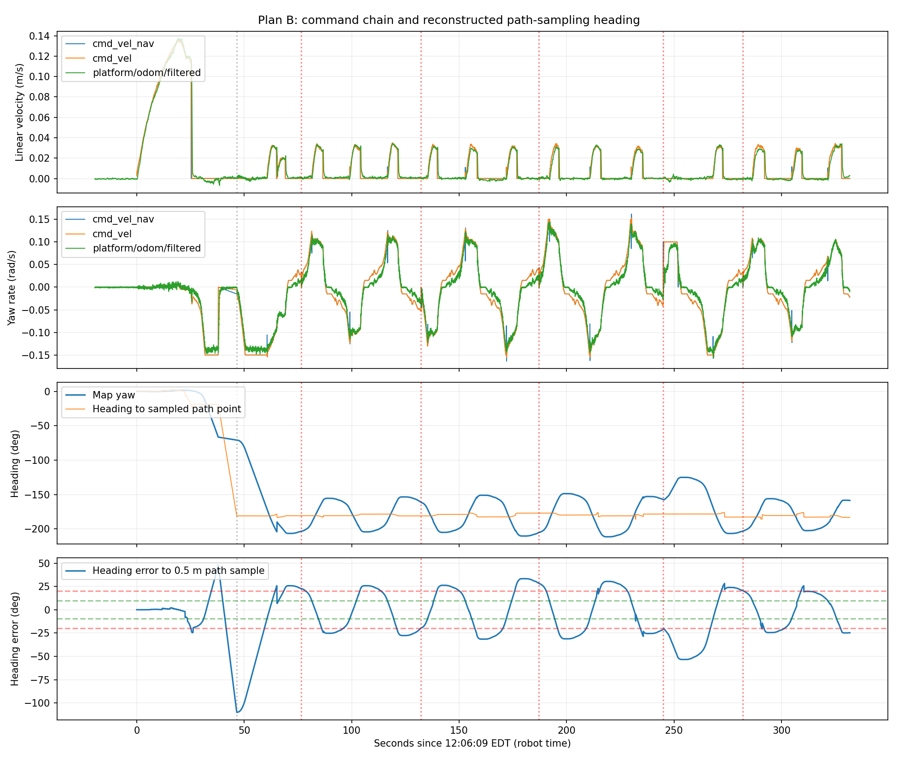

# Jackal Turn Oscillation and a Slower Shim Comparison

The latest bag confirms `PathAngleCritic.max_angle_to_furthest: 0.10` is active, but the return trip still oscillates. The first straight goal succeeded in approximately 38 s; the second required turning back and showed repeated approximately ±30° direction errors. Lowering Shim target speed is a possible next comparison, but MPPI still commands continued same-direction turning after handoff. The behavior alone does not establish excessive body inertia or inadequate braking.

Data: `~/Desktop/jackal_rosbag_repo/debug/jackal_20261013_120526/`; approximately 351.9 s, 259817 messages, 3 reported transport losses. Navigation commands span 12:06:09–12:11:41 EDT on October 13, 2026, by robot time. Original bags and robot configuration were not modified.

## Active configuration

Compared with `114556`, only controller `FollowPath.PathAngleCritic.max_angle_to_furthest` changed from 0.35 to 0.10; smoother parameters match. Both initial/final snapshots show 0.10.

| Item | Runtime value |
| --- | --- |
| Shim target angular speed | 0.15 rad/s |
| Shim angular acceleration/deceleration limit | 0.30 rad/s² |
| Shim engagement / handoff thresholds | 0.35 / 0.17 rad |
| MPPI angular limit | 0.20 rad/s |
| Smoother angular deceleration limit | −0.30 rad/s² |
| Progress check | 0.20 m / 30 s, SimpleProgressChecker |

## Evidence of overshoot

Times below are relative to the first navigation command. A sign change in direction error means the body crossed the sampled path direction. Path samples are reconstructed using the recorded path and 0.5 m rule, not internal controller state.

| Relative time | Path direction error | Forward command m/s | Angular command rad/s | Measured angular speed rad/s |
| --- | --- | --- | --- | --- |
| 100 s | −4.1° | 0.020 | −0.104 | −0.107 |
| 101 s | +2.2° | 0.031 | −0.098 | −0.101 |
| 102 s | +8.5° | 0.031 | −0.104 | −0.108 |
| 103 s | +15.0° | 0.029 | −0.100 | −0.104 |
| 104 s | +21.3° | 0.028 | −0.094 | −0.098 |

After crossing alignment, commands still request the original turning direction for several seconds. Shim in-place rotation outputs zero linear velocity; forward FollowPath components show MPPI has taken over. [Rotation Shim source](https://github.com/ros-navigation/navigation2/blob/jazzy/nav2_rotation_shim_controller/src/nav2_rotation_shim_controller.cpp)

During 80–240 s, reconstructed direction error ranges from −31.5° to +33.3°. Most cycles take approximately 35–40 s. Linear commands are zero for approximately 70% of the command interval, with no negative linear commands. The first goal succeeds; the second remains incomplete at recording end. There are 5 progress failures and one approximately 0.52 rad recovery spin near 245 s. Most periodic oscillation precedes that recovery.



Map heading is unwrapped across ±180°; a raw-yaw transition from +179° to −179° is not a 358° turn. The third plot's sample direction supports path-tracking analysis only; final-heading control also uses goal orientation.

## Actual braking and localization

A rough command/raw-odometry angular fit gives approximately 0.22 s delay and 0.97 scale, not a complete chassis identification. After the first goal succeeds, the smoother ramps approximately −0.15 rad/s to zero in about 0.5 s. Measured angular speed reaches −0.0095 rad/s after approximately 1 s. Total continued rotation during 2 s after success is approximately 4.5°, including the software ramp and chassis response. Residual rotation exists, but differs from the 20–30° deviations caused by continuing commands.

At 65.3 s, `map → odom_start` corrects by approximately 0.89 m and 14.8°, warranting separate SLAM/scan-matching investigation. The 100–104 s example above does not cross that jump, and later oscillations still match sustained turning commands. Smoother and Collision Monitor outputs match when aligned by message stamps; repeated truncation by the latter is not evident.

## Next comparison: lower only Shim speed

Separate candidate: [nav2_low_speed_indoor_plan_b_slow_shim.yaml](../../config/jackal/nav2_low_speed_indoor_plan_b_slow_shim.yaml). Relative to this heading configuration, only `FollowPath.rotate_to_heading_angular_vel` changes from 0.15 to 0.10 rad/s, approximately 8.6°/s to 5.7°/s. YAML-difference and ROS parameter parsing checks passed; deployment and field effects remained unverified.

Cancel the goal and stop the robot, keep Nav2 running, then execute on Jackal:

```bash
source /etc/clearpath/setup.bash
ros2 param set /j100_0949/controller_server FollowPath.rotate_to_heading_angular_vel 0.10
ros2 param get /j100_0949/controller_server FollowPath.rotate_to_heading_angular_vel
```

Confirm successful setting and readback 0.1. This changes only the current process; restart restores active YAML values. Temporary rollback command:

```bash
ros2 param set /j100_0949/controller_server FollowPath.rotate_to_heading_angular_vel 0.15
```

Retain `max_angular_accel: 0.3` and smoother angular deceleration `−0.3`. Shim `max_angular_accel` is used for acceleration, deceleration, and stopping-speed estimation; lowering it is not simply stronger braking. [Rotation-speed calculation](https://github.com/ros-navigation/navigation2/blob/jazzy/nav2_rotation_shim_controller/src/nav2_rotation_shim_controller.cpp#L284-L310)

This candidate lowers only Shim target speed. MPPI retains a 0.20 rad/s limit, and current angular speed at handoff may be higher; it does not strictly limit every navigation turn to 0.10 rad/s.

Compare first with a forward goal requiring only a small correction in open space, with its arrow along travel; record before sending the goal. At 0.10 rad/s, a 180° turn theoretically needs at least 31.4 s, exceeding the current 30 s position-progress allowance. Do not use a U-turn alone to judge this speed change. Cancel and save after one clear left-right overshoot cycle.

If oscillation persists, inspect commands around handoff and MPPI predictions. Do not keep lowering speed and claim the issue is fixed. For persistent deployment, back up the active file, copy the candidate to `~/jackal_nav2/nav2_low_speed.yaml`, and restart Nav2. [Deployment and rollback](../../Docs/Jackal_Quick_Start_2026-10-13.md#8-plan-b-add-rotation-shim)

Full values: [summary.json](summary.json); intervals with forward commands: [forward_intervals.csv](forward_intervals.csv).
