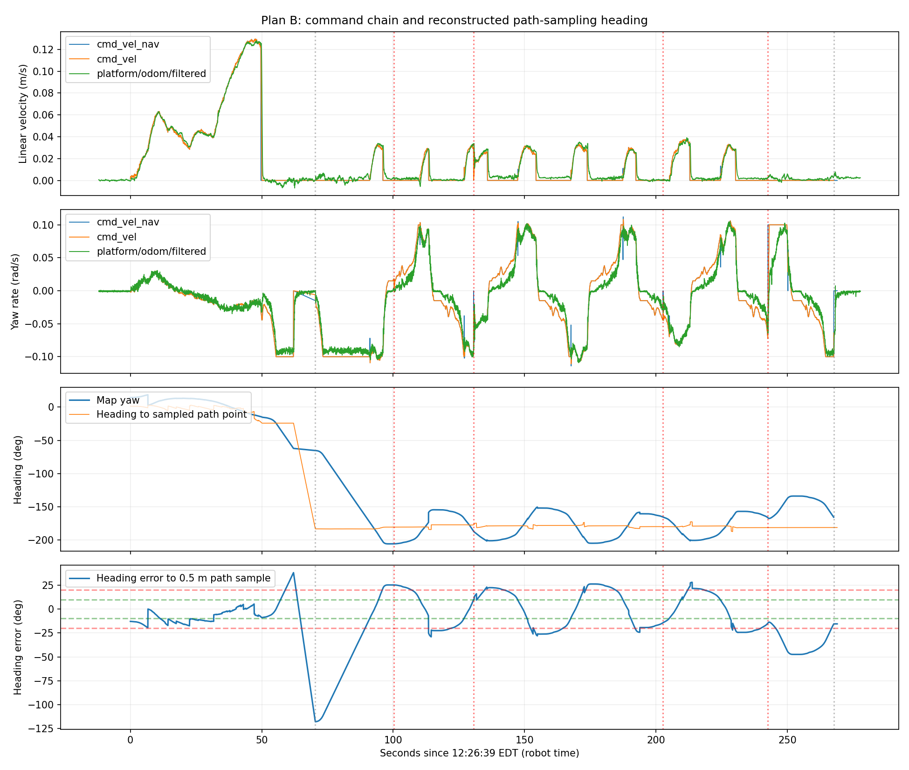

# Jackal: Lower MPPI Angular Speed and Count Rotation as Progress

The latest bag confirms Shim at 0.10 rad/s and the PathAngleCritic threshold at 0.10 rad. The first goal succeeds, but the return trip still oscillates; MPPI continues same-direction commands after crossing path heading. As requested, the new candidate lowers MPPI angular limit to 0.08 rad/s, shared smoother bounds to ±0.10 rad/s, and uses PoseProgressChecker to recognize rotational progress. Local plugin-loading checks passed; deployment and field effects remain unverified.

Bag: `~/Desktop/jackal_rosbag_repo/debug/jackal_20261013_122553/`. Approximately 290.5 s, 212383 messages, 8 reported transport losses. Valid navigation commands cover 12:26:39–12:31:08 EDT on October 13, 2026, by robot time. Original data is retained.

## Bag findings

| Item | Result |
| --- | --- |
| Shim target angular speed | 0.10 rad/s in both snapshots |
| MPPI `wz_max` | Still 0.20 rad/s |
| PathAngleCritic threshold | 0.10 rad before and after |
| First goal | Succeeded in approximately 62.1 s |
| Return goal | Canceled after approximately 197.3 s; did not succeed |
| Repeated path-direction error | Approximately −29.1° to +27.9° during 100–235 s |
| Controller angular command range | Approximately −0.114 to +0.112 rad/s |
| Absolute angular speed during forward commands on return | Median approximately 0.087, 95th percentile approximately 0.104 rad/s |
| Progress failures | 4 |
| Recovery spin | 1, 0.52 rad, at approximately 242.6 s |
| Negative linear commands | None recorded |

Lowering Shim reduced command peaks relative to the previous run, but repeated nearly ±30° errors persist. Lower peaks alone do not establish that oscillation is resolved. Direction errors are reconstructed from recorded global paths, the 0.5 m sample rule, and navigation poses, not internal controller telemetry. Initial conditions differ between runs, so not every change can be attributed to this parameter.



Yaw is unwrapped across ±180°. The third plot's sampled-path direction supports path-following analysis; final in-place alignment also uses goal heading. The gap is waiting between goals. Recovery rotation in the fourth plot must not be treated as MPPI tracking error.

## MPPI continues turning after crossing alignment

Times are relative to the first navigation command. The selected interval avoids both large map corrections:

| Relative time | Direction error to sampled path point | Forward command m/s | Angular command rad/s | Measured angular speed rad/s |
| --- | --- | --- | --- | --- |
| 92 s | −4.6° | 0.015 | −0.093 | −0.094 |
| 93 s | +1.0° | 0.027 | −0.091 | −0.094 |
| 94 s | +7.2° | 0.032 | −0.101 | −0.108 |
| 95 s | +14.5° | 0.030 | −0.103 | −0.108 |
| 96 s | +21.1° | 0.028 | −0.096 | −0.100 |
| 98 s | +25.1° | 0 | +0.013 | −0.002 |

After direction error crosses zero, commands remain near −0.10 rad/s for several seconds. Forward components in these FollowPath commands indicate MPPI is operating because Shim alignment has zero linear output. Measured angular speed broadly follows commands, so mechanical residual rotation alone cannot explain this overshoot. [Shim source](https://github.com/ros-navigation/navigation2/blob/jazzy/nav2_rotation_shim_controller/src/nav2_rotation_shim_controller.cpp)

The combination does not substantially reduce angular commands at the needed time; this does not prove MPPI has no deceleration capability. `wz_max` limits speed, while `az_max` constrains modeled acceleration/deceleration. Lowering the limit does not add an explicit remaining-angle stopping rule. Prediction and critic scores still jointly determine MPPI trajectory selection. [MPPI source](https://github.com/ros-navigation/navigation2/blob/jazzy/nav2_mppi_controller/src/optimizer.cpp)

## Progress failures during rotation

The first return-trip `Failed to make progress` occurs approximately 30.02 s after the goal starts. Raw odometry shows approximately 0.123 m net displacement and 140.3° net rotation. Old `SimpleProgressChecker` recognizes only position changes over 0.20 m, so substantial turning still fails after 30 s.

New configuration:

```yaml
progress_checker:
  plugin: nav2_controller::PoseProgressChecker
  required_movement_radius: 0.2
  required_movement_angle: 0.35
  movement_time_allowance: 30.0
```

Relative to the last reference, displacement above 0.20 m **or** shortest angular change above 0.35 rad (approximately 20°) resets the reference and timer. Failure occurs only after more than 30 s with neither threshold reached. It measures net change from the reference, not accumulated distance/rotation, and does not require getting closer to the goal. [PoseProgressChecker source](https://github.com/ros-navigation/navigation2/blob/jazzy/nav2_controller/plugins/pose_progress_checker.cpp)

**Back-and-forth oscillation may continuously satisfy rotational progress.** This can reduce false failures during useful in-place turns, but does not cure oscillation and may allow it to continue longer without recovery. Compare heading convergence, useful forward duration, and goal outcomes, not only error counts.

## Candidate scope

File: [nav2_low_speed_indoor_turn_control.yaml](../../config/jackal/nav2_low_speed_indoor_turn_control.yaml). Five parameter keys differ from the previous slow-Shim configuration; see [config_changes.json](config_changes.json).

| Parameter | This run | New candidate |
| --- | --- | --- |
| `FollowPath.wz_max` | 0.20 | **0.08 rad/s**, approximately 4.6°/s |
| `velocity_smoother.max_velocity[2]` | 0.20 | **0.10 rad/s** |
| `velocity_smoother.min_velocity[2]` | −0.20 | **−0.10 rad/s** |
| `progress_checker.plugin` | SimpleProgressChecker | **PoseProgressChecker** |
| `progress_checker.required_movement_angle` | Unused | **0.35 rad** |

Shim remains at 0.10 rad/s, so the shared smoother also permits 0.10 for alignment. MPPI tracking targets an upper limit of 0.08; not every phase is limited to 0.08. MPPI output passes through internal filtering and downstream smoothing. Inspect recorded commands and odometry; software limits do not guarantee actual chassis speed never briefly exceeds the value.

Retain `FollowPath.az_max: 0.3`, Shim `max_angular_accel: 0.3`, and smoother angular deceleration `−0.3` to avoid simultaneously reducing braking capability. Linear limits remain 0.20 m/s forward / 0.10 m/s reverse. The 0.10 rad PathAngleCritic threshold, other critics, sampling, footprint, inflation, and collision checking remain unchanged. This requested candidate combines speed and progress changes, so later effects cannot be attributed to either alone.

Changing the progress checker requires plugin reconfiguration/loading. Restart Nav2 with the complete candidate; do not change only the runtime `progress_checker.plugin` string and treat readback as proof of a plugin switch. [Controller Server plugin loading](https://github.com/ros-navigation/navigation2/blob/jazzy/nav2_controller/src/controller_server.cpp#L121-L140)

## Validation and next recording

- ROS parameter parsing passed for 99 controller and 12 smoother parameters.
- Local Nav2 in localhost-only Domain 213 and a separate namespace successfully configured real Shim, MPPI, PoseProgressChecker, and velocity smoother, read back new values, and cleaned up. Nodes were never activated and no motion goals were sent. See [config_validation.txt](config_validation.txt).
- [Operating manual section 9](../../Docs/Jackal_Quick_Start_2026-10-13.md#9-reduce-mppi-angular-speed-and-include-rotation-in-progress-checking) includes upload, active-YAML backup, startup logs, and readback. SLAM need not restart for this Nav2 change.
- Record before sending goals. Test a straight segment in open space, then an approximately 90° turn with the target arrow along travel; test final-heading alignment separately. Cancel and save after one clear left-right overshoot cycle without waiting for progress failure.
- If reduced-speed commands still retain the same sign after crossing alignment, inspect MPPI predictions/scores and Shim handoff rather than relying on more permissive progress checking.

## Other limitations

Map corrections occur near 6.66 s (0.36 m, −15.8°) and 113.45 s (approximately 1.08 m, +14.8°), requiring separate SLAM/scan-matching checks. The 92–98 s overshoot example avoids both; not all deviations have one established cause.

Controller/smoother before/after parameters match. Final snapshots lack both local/global costmap nodes, so their parameters cannot be claimed verified before/after. Host receipts and robot stamps share approximately 1.49 s difference; analysis mainly uses robot stamps, and this offset is not direct network/control latency. A rough command/raw-odom angular fit suggests approximately 0.22 s delay, not a chassis-dynamics identification result.

Other results: [summary.json](summary.json), [forward-interval statistics](forward_intervals.csv).
