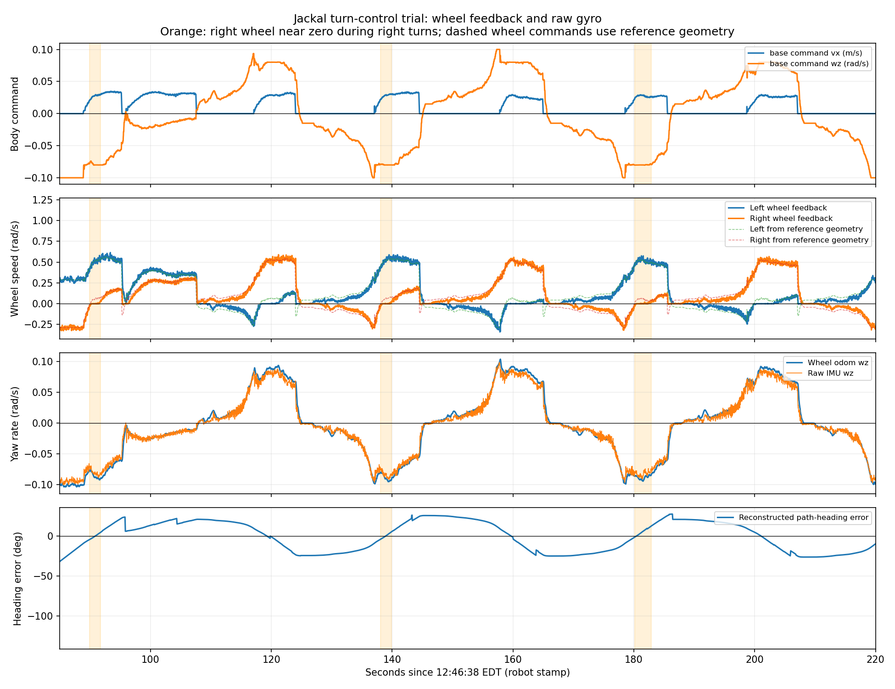

# Jackal Inside-Wheel Stalling and Lateral Sliding During Turns

The bag confirms the observed nearly stationary inside wheels: right-wheel feedback can remain near zero during right turns, and left-wheel feedback does the same during left turns. MPPI often combines approximately 0.028 m/s forward with 0.08 rad/s rotation, producing a tight turn and very low inside-wheel target speed. A low-speed dead zone or static friction may further stall that wheel. The data does not establish a right-motor fault, and encoders alone cannot quantify whole-body lateral slip.

The user observed both arc turning and body translation sideways. Jackal skid steering inherently involves lateral tire/ground slip, but this bag cannot determine how much observed lateral motion exceeds normal turning slip. Motion-model error, low-speed execution, and path control require separate checks.

Data directory: `~/Desktop/jackal_rosbag_repo/debug/jackal_20261013_124612/`. Approximately 310.6 s, 229987 messages, 6 transport losses. Navigation commands cover 12:46:38–12:51:37 EDT on October 13, 2026, by robot time. No copied `robot_logs` were available; [node logs](rosout.txt) were recovered from bag `/rosout` and checked against BT/action data.

## New settings are active, but oscillation persists

Both snapshots confirm MPPI `wz_max: 0.08`, Shim `rotate_to_heading_angular_vel: 0.10`, and PoseProgressChecker `0.20 m / 0.35 rad / 30 s`. The first goal succeeds in approximately 56 s; the second does not arrive and ends with `Goal canceled`. No `Failed to make progress` or executed Spin/BackUp/Wait appears in the command interval, yet reconstructed return-trip direction error remains approximately −26.4° to +27.2° during 100–280 s.

This matches the stated PoseProgressChecker limitation: angular changes can keep resetting progress, including oscillation. Fewer errors do not establish better tracking.

Shared velocity commands remain within ±0.10 rad/s. Most forward-component MPPI outputs lie near ±0.08 rad/s, with occasional samples near ±0.09; the internal MPPI bound therefore does not replace final downstream limits. Repeated sign changes are still driven by control commands.

## Specific evidence of right-wheel stalling

Medians from one right-turn interval at robot time **12:48:08.310–12:48:10.130**, approximately 1.82 s:

| Quantity | Recorded value |
| --- | --- |
| Chassis forward command | 0.0278 m/s |
| Chassis angular command | −0.0800 rad/s, right turn |
| Left-wheel encoder rotational speed | 0.508 rad/s |
| Right-wheel encoder rotational speed | Approximately 0 rad/s |
| Left encoder position change | Approximately 0.900 rad |
| Right encoder position change | Approximately 0.00018 rad |
| Raw IMU Z angular velocity | Approximately −0.0809 rad/s |

Wheel rotation and body yaw rate are different quantities. Right encoder position also barely changes, so this is not only an instantaneous zero speed reading.

Similar right-wheel intervals occur around 12:48:56, 12:49:38, 12:50:19, and 12:50:58; left turns show several left-wheel intervals too. During pure in-place right turns near −0.10 rad/s, left/right wheels can rotate oppositely at approximately +0.287 / −0.286 rad/s, so neither side is permanently unable to turn. Intermittent drive faults are not excluded, but a failed motor on one side is not the first conclusion.

Same-side front/rear `platform/joint_states` feedback is identical. Clearpath J100 reference configuration says each side's wheels share one control signal. These are not four independent ground-motion measurements; equal front/rear feedback does not prove each tire is slip-free. [J100 reference configuration](https://github.com/clearpathrobotics/clearpath_common/blob/jazzy/clearpath_control/config/j100/control/diff_4wd.yaml)



Orange regions mark right turns with nearly stationary right wheels. Dashed wheel-speed curves use locally installed Clearpath reference geometry only to explain the command combination. This bag lacks actual chassis-controller parameters and motor setpoints, so dashed curves are not measured motor commands.

## Why a low-speed turn can nearly stop one side

Differential-drive wheel-rim velocities satisfy:

```text
Left rim velocity = forward velocity − body angular velocity × effective wheel separation / 2
Right rim velocity = forward velocity + body angular velocity × effective wheel separation / 2
```

A right turn has negative angular velocity, making the right side slower. [ros2_control differential-drive conversion](https://github.com/ros-controls/ros2_controllers/blob/jazzy/diff_drive_controller/src/diff_drive_controller.cpp#L273-L277)

The local J100 reference uses separation 0.37559 m and multiplier 1.5, giving approximately 0.563 m effective separation; wheel radius is 0.098 m. With these reference values, the commands imply approximately 0.050 m/s left rim speed and **0.0053 m/s** right rim speed, or only **0.054 rad/s** right-wheel rotation. That is very small, while recorded right-wheel speed is nearly zero. This warrants checking low-speed dead zones, static friction, and drive control, but absent motor targets/current prevent identifying which is responsible.

Fitting recorded wheel speeds to wheel odometry yields radius approximately 0.097 m and effective separation approximately 0.566 m, close to the reference. This checks software-conversion consistency only; it neither calibrates physical separation nor proves absence of slip. Footprint width cannot replace wheel-separation parameters.

The nominal body turn radius is approximately `0.0278 / 0.08 = 0.35 m`. **Low absolute speed can still mean a tight arc.** Inside-wheel stalling depends on the combination of forward and angular velocity, not each upper limit separately.

## A nonrotating wheel can still move sideways with the body

Jackal steers through differential speeds of fixed-orientation left/right wheels. Tires can be dragged laterally during turns; zero encoder rotation does not imply the tire contact location is stationary relative to the ground. Jackal experiments also describe inherent skid-steer sideslip that a simple differential model cannot fully represent. [Skid-steer kinematics study](https://amrl.cs.utexas.edu/papers/icra2019_skid_steer_kinematics.pdf)

All Nav2 `linear.y` commands are zero. Differential-model wheel odometry cannot independently measure lateral slip, and the current EKF fuses its lateral velocity, so filtered output is not independent ground truth either. Raw IMU can confirm body rotation, but short-duration acceleration alone cannot reliably recover lateral slip distance.

Near 95.83 s, `map → odom_start` corrects approximately 0.78 m and 14°. SLAM matching or odometry error may contribute; this jump is not proof of 0.78 m physical sliding. The 12:48:08 wheel-speed interval avoids it.

## Additional diagnostics prepared for the next run

No further Nav2 values were changed. Host recording support now adds:

- `platform/motors/cmd_drive`: actual left/right drive setpoints and control mode.
- `platform/motors/feedback`: encoder speed/position, current, duty cycle, temperature, drive faults, and mode.
- `platform/dynamic_joint_states` and diagnostic topics.
- Parameter snapshots for `platform_velocity_controller`, `j100_hardware`, and `j100_hardware_interface`; these nodes existed but were omitted by the old script.

Message names/types were checked against this run's ROS graph. New recording cannot recover absent messages from the old bag. All `JointState.effort` values are NaN and cannot substitute for motor current.

Continue using the existing Host command, keeping Nav2/SLAM running before starting:

```bash
cd ~/Desktop/Jackal_Turtlebot_Platform
bash scripts/record_jackal_debug.sh
```

Wait for snapshots, press Space, and wait for subscriptions before observing short left/right turns. To quantify lateral sliding, simultaneously film the robot and ground references with a fixed external camera under the same floor/load/tire conditions. This provides evidence independent of wheel odometry. Cancel after obvious deviation and save a short segment. Wait for `Saved` after recording ends before stopping Nav2/SLAM.

Use these evidence branches next:

| Observation | Priority check |
| --- | --- |
| Inside motor target itself is tiny and encoders are near zero | Turn curvature and low-speed drive response |
| Inside target is clearly nonzero but encoder stays still, with abnormal current/faults | Drive, load, static friction, or mechanical resistance |
| Wheel speeds follow targets but an external camera confirms substantial lateral drift | Tire/ground contact, load, and slip model |

Do not change wheel separation multiplier to 1.0 or raise minimum forward speed to force inside-wheel rotation based only on this observation. Both require actual parameters and low-speed response evidence. Switching Nav2 to an omnidirectional model cannot eliminate slip; Jackal has no controlled lateral drive capability.

Full intervals: [inner_wheel_near_stop.csv](inner_wheel_near_stop.csv); statistics: [summary.json](summary.json); added capture instructions: [debug manual section 6](../../Docs/Jackal_Debug_Recording_2026-10-13.md#6-inside-wheels-stopping-or-lateral-sliding-during-turns).
