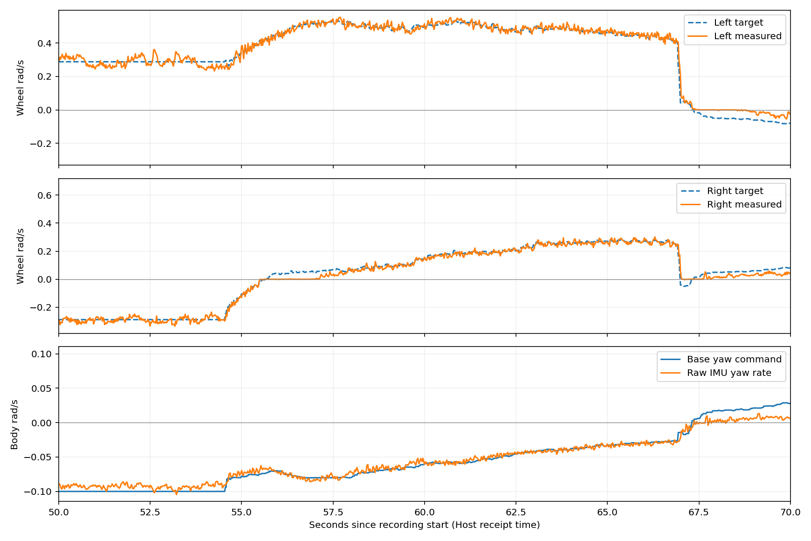
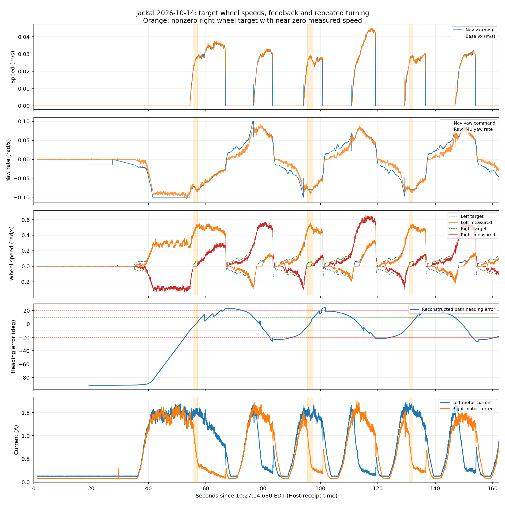

# Jackal Motor Wheel-Speed and Navigation Oscillation Analysis

The October 14, 2026 baseline confirms repeated direction reversals in navigation commands, while inside-wheel encoders can remain near zero despite tiny nonzero speed targets. Both sides show this, with no recorded drive-fault flags. Prioritize separating path tracking/repeated Shim engagement from low-speed wheel execution; not all oscillation can be attributed to inertia or one failed motor.

Data: `~/Desktop/jackal_rosbag_repo/debug/jackal_20261014_102639/`. Recording: 162.30 s, 152559 messages; Host receipt time approximately 10:27:14.681–10:29:56.979 EDT. Robot log directories are `nav_20261014_142501` and `slam_20261014_142434`, named in the robot's timezone. The same `robot_logs` also includes yesterday's logs; only this session's interval is used here.

## Configuration and capture completeness

Initial/final controller_server and velocity_smoother parameters match yesterday's last bag. Key settings:

| Item | Actual value |
| --- | --- |
| MPPI angular limit | 0.08 rad/s |
| Shim angular target | 0.10 rad/s |
| Shim checks every new path | `rotate_to_heading_once: false` |
| Shim engagement / disengagement | 0.35 / 0.17 rad, approximately 20° / 10° |
| Shared smoother angular limit | ±0.10 rad/s |
| Progress check | PoseProgressChecker, 0.20 m OR 0.35 rad, 30 s |
| Chassis separation and multiplier | 0.37559 m × 1.5, effective 0.563385 m |
| Wheel radius | 0.098 m, both radius multipliers 1.0 |
| Chassis angular limit | ±0.6 rad/s |
| Chassis angular acceleration/deceleration limits | Acceleration magnitude 0.6 rad/s², deceleration magnitude 4.0 rad/s² |

The chassis 0.6 rad/s value is an allowed maximum. Downstream commands in this run never exceed ±0.10 rad/s, so that setting alone is not evidence of excessive actual commanded speed. Motor targets are wheel rotation rad/s, not body yaw rad/s.

Enhanced capture contains 8059 `platform/motors/cmd_drive` and 8060 `platform/motors/feedback` messages, plus initial/final chassis-controller parameters. `recorder.log` reports no transport losses, which does not prove every publisher-to-receiver path was lossless. Collision-monitor state has no messages and cannot directly establish each limiting state.

Final EKF queries timed out, leaving no valid EKF `params_after`; readable initial EKF parameters remain in `params_before`. Two uninitialized collision-monitor parameters were skipped by the snapshot script; this does not establish collision-checking failure.

## Inside wheels receive nonzero targets but barely rotate

Medians during a right turn at Host time **10:28:50.033–10:28:52.075**, approximately 2.04 s:

| Quantity | Recorded value |
| --- | --- |
| Chassis forward command | 0.02735 m/s |
| Chassis right-turn command | −0.08000 rad/s |
| Left target / actual wheel speed | 0.50943 / 0.50570 rad/s |
| Right target / actual wheel speed | **0.04931 / approximately 0 rad/s** |
| Right encoder position change | Approximately 0.00448 rad, equivalent to approximately 0.44 mm rim travel |
| Right drive current | Approximately 0.56 A |
| Raw IMU angular speed | −0.08191 rad/s |
| Drive-fault flags on both sides | Both false |

The right-wheel target is now directly recorded rather than inferred from reference geometry. Left turns show the same pattern: from Host 10:28:32.615 for approximately 1.84 s, left target is approximately 0.06194 rad/s, actual speed near zero, and left current approximately 0.70 A.

Among enabled-drive samples with absolute targets 0.02–0.05 rad/s, approximately 93% of left and 89% of right actual speeds are below 0.03 rad/s. These bins include transitions; neither 0.05 nor 0.10 rad/s is a calibrated fixed dead-zone boundary. Continuous intervals above also inspect encoder position, supporting substantial execution error at extremely low target speeds.

Current and duty cycle are not uniformly zero, but feedback current is bridge supply current and cannot directly determine tire-ground force. Low-speed friction, lateral dragging, controller dynamics, and measurement resolution remain to be separated. This bag does not support choosing motor PID gains. Wheel rotation feedback alone cannot measure body sideslip.



The plot shows another right turn with a nonzero right target and near-zero actual speed. Continuous intervals: [inner_wheel_intervals.csv](inner_wheel_intervals.csv); target-speed bins: [wheel_tracking_by_speed.csv](wheel_tracking_by_speed.csv).

## Oscillation includes sustained same-direction commands and in-place corrections

Reconstructing from global paths, a 0.5 m forward path sample, and navigation poses, direction error after the initial large turn still oscillates between approximately **−26.4° and +24.4°**. This is a reconstructed sample-direction error, not MPPI critic input or directly recorded controller mode.

During forward motion at 76.8–83.0 s, reconstructed error changes from approximately +8.9° to −25.2° while Nav2 retains positive angular output, decreasing approximately +0.083 to +0.060 rad/s. Negative-angular in-place correction follows. Similar cycles alternate.

Several zero-forward corrections begin above approximately 20° error and end around 10°, matching Shim's configured thresholds. INFO logs do not record per-cycle Shim/MPPI selection, so attribution remains an inference from parameters, commands, and source. [Rotation Shim implementation](https://github.com/ros-navigation/navigation2/blob/1.3.12/nav2_rotation_shim_controller/src/nav2_rotation_shim_controller.cpp)



For six defined turn-sign reversal events, the delay from chassis command crossing 0.015 rad/s in the opposite direction to raw IMU crossing 0.005 rad/s that way is approximately 0.06–0.24 s. Sampling/receipt errors are included; this is not a full braking-response calibration. It does not show prolonged inertial rotation sufficient by itself to explain sustained tens-of-degrees oscillation.

For relatively stable angular commands, bias-corrected raw IMU/chassis angular-command ratio has median approximately 0.94. This approximate ratio must not directly calibrate wheel-separation multiplier: tire contact, low-speed wheel stalls, and measurement error affect it. Separation/radius influence both wheel commands and wheel odometry; retain them pending independent calibration. [Differential-drive parameters](https://control.ros.org/jazzy/doc/ros2_controllers/diff_drive_controller/doc/userdoc.html)

## Goals and emergency-stop state

- Goal 1 is sent around recording time 19.2 s and canceled at 27.4 s. Diagnostics show `E-stop Triggered: True` for approximately the first 30 s and disabled motor mode. Exclude this interval from tracking-performance samples.
- Goal 2 is sent around 35.0 s to approximately `(0.53, -2.30)` from approximately `(1.00, 0.00)`, initially requiring nearly 90° rotation. No separate straight goal was completed first.
- At bag end, pose is approximately `(0.872, -1.244)` and feedback remaining path length approximately 1.12 m. No goal-success log appears.
- Nav2 logs contain no `Failed to make progress` or executed Spin/BackUp/Wait. Later large corrections occur within FollowPath.
- Recording pauses at Host 10:29:56.979; navigation is canceled approximately 6 s later, confirmed by retrieved Nav2 logs. The bag misses final cancellation/stopping response. Next time cancel, stop, and record a few more seconds before ending the bag.

## Other diagnostics and limitations

Median Host receipt minus robot stamp is approximately 2.079 s across several independent streams, possibly mainly clock difference, not motor-control delay. `cmd_drive` has no header, so wheel comparisons use common Host receipt time. Check clock synchronization before the next run. All absolute chart times are labeled Host receipt time.

Hardware diagnostics continuously report execution jitter, with cumulative maximum write time approximately 42.7 ms; corresponding controller_manager warnings precede navigation goals. During motion, motor command/feedback receipts have approximately 20 ms periods and approximately 27 ms maximum, without repeated second-long stalls. Goal 2 Nav2 command periods have approximately 50 ms median and 97 ms maximum. Retain these diagnostics without interpreting cumulative warnings as every cycle timing out.

LiDAR diagnostics expect 20 Hz but measure approximately 10 Hz. Check sensor mode against diagnostic expectations; the warning is not direct evidence of wireless loss. Maximum adjacent SLAM `map → odom_start` correction is approximately 0.124 m / 7.60°, affecting instantaneous direction error but not measuring physical sideslip.

`ROS_LOCALHOST_ONLY` deprecation notices have no direct established connection to these control effects; parameters, topics, and logs were received.

## Next single-parameter comparison

This analysis does not change baseline YAML or robot runtime parameters. Next test only `FollowPath.rotate_to_heading_once: true`, retaining all other settings. It tests whether repeated replans to the same goal trigger Shim and worsen stop-start motion; it neither fixes low-speed wheel response nor guarantees MPPI same-direction turning disappears.

After Nav2 starts, cancel any goal, stop the robot, and run on Jackal:

```bash
source /etc/clearpath/setup.bash
ros2 param set /j100_0949/controller_server FollowPath.rotate_to_heading_once true
ros2 param get /j100_0949/controller_server FollowPath.rotate_to_heading_once
```

After confirming true, create a new Host bag so `params_before` captures it:

```bash
cd ~/Desktop/Jackal_Turtlebot_Platform
bash scripts/record_jackal_debug.sh
```

Test straight and small-angle goals with adequate space. Cancel and retain data if deviation persists. Compare error amplitude, zero-forward corrections, wheel-speed error, and goal outcomes; absence of progress failures alone is insufficient. If repeated in-place corrections decrease but path deviation grows, restore false and continue investigating MPPI tracking/low-speed execution.

Restore command:

```bash
ros2 param set /j100_0949/controller_server FollowPath.rotate_to_heading_once false
```

This is a runtime-only comparison; `ros2 param set` does not persist YAML. Reproduction scripts: [extract.py](extract.py), [analyze.py](analyze.py); full statistics: [summary.json](summary.json); bag logs: [rosout.txt](rosout.txt).
