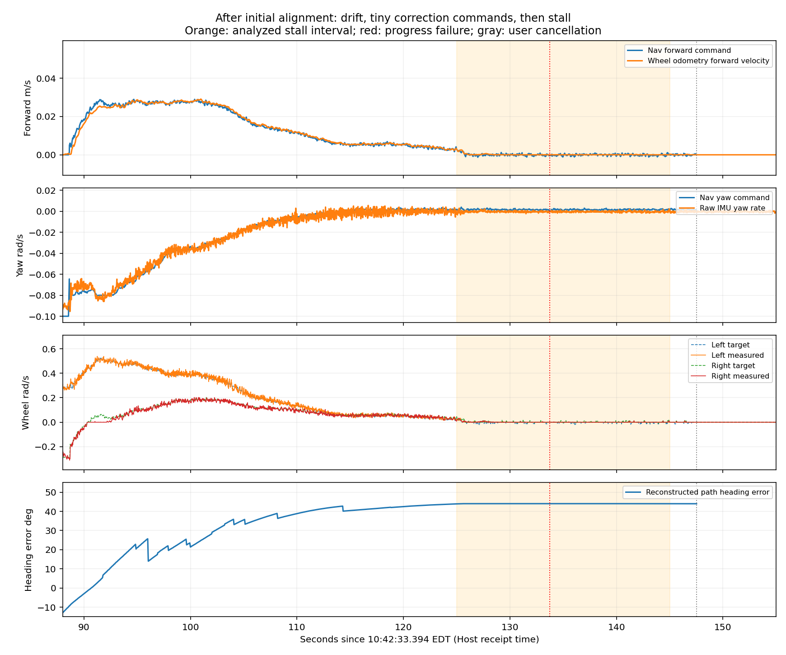
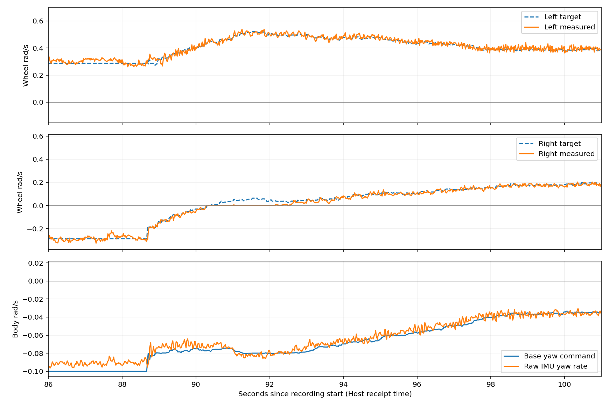

# Jackal: Deviation and Stalling After Initial Alignment Only

Changing `FollowPath.rotate_to_heading_once` from `false` to `true` reduced repeated in-place corrections, but after initial alignment for goal 2, path-direction error grew to approximately 44° and motion nearly stopped. This matches the field observation "deviates, then stops moving." During the stall, Nav2 correction commands were already tiny and most downstream motor targets were zero. This alone does not establish motor failure or excessive inertia preventing braking.

Restore `rotate_to_heading_once: false` to end this diagnostic trial. Next, separately test MPPI `PathAngleCritic.cost_weight: 2.0 → 5.0` to strengthen heading preference. This is an unverified trial value, not a proven fix. Only offline analysis outputs were generated; navigation YAML, robot parameters, and startup state were unchanged.

## Data and actual configuration

- Directory: `~/Desktop/jackal_rosbag_repo/debug/jackal_20261014_104150/`.
- Host receipt time: 2026-10-14 10:42:33.394–10:45:08.983 EDT; approximately 155.59 s, 149164 messages.
- Motor targets: 7723 messages; feedback: 7763. Recording ended normally with 4 reported transport losses.
- No matching external `robot_logs` were found in the latest directory. Bag `/rosout` provides goals, progress failures, costmap clearing, and cancellation events.
- Before/after snapshots match for key Nav2/chassis parameters. Relative to `102639`, controller_server changes only `rotate_to_heading_once: false → true`. Goals/routes differ, so this is not a strict same-route comparison.
- Initial EKF query failed; the final snapshot retains readable EKF values. Missing-message-definition warnings did not prevent offline decoding with locally installed interfaces.

| Parameter | This run |
| --- | --- |
| MPPI `wz_max` | 0.08 rad/s |
| Shim `rotate_to_heading_angular_vel` | 0.10 rad/s |
| Shim `rotate_to_heading_once` | **true** |
| Shim engagement / disengagement direction thresholds | 0.35 / 0.17 rad, approximately 20° / 10° |
| Smoother maximum velocity | `[0.20, 0.0, 0.10]` |
| PathAngleCritic weight / activation angle | 2.0 / 0.10 rad |
| PathAngleCritic distance at which near-goal scoring stops | 0.50 m |
| PoseProgressChecker | Pose change of 0.20 m OR 0.35 rad, 30 s |
| Goal position / heading tolerance | 0.25 m / 0.25 rad |

Local baseline [nav2_low_speed_indoor_turn_control.yaml](../../config/jackal/nav2_low_speed_indoor_turn_control.yaml) remains `rotate_to_heading_once: false` and `PathAngleCritic.cost_weight: 2.0`.

## What happened

Times are relative to Host recording start; robot log timestamps are approximately aligned using the observed clock offset.

| Time | Event and interpretation |
| --- | --- |
| 8.70 s | First goal `(2.29, 0.03)`, starting near `(1.00, 0.00)`, mostly straight. |
| 56.95 s | User sends goal 2, replacing goal 1. Closest distance to goal 1 is approximately 0.261 m, outside the 0.25 m tolerance; the old goal's ABORTED status is not an independent autonomous failure. |
| 58.40–88.54 s | Goal 2 initially requires approximately 140° right rotation. A roughly 30.1 s zero-forward turn reduces reconstructed error from approximately −140° to −10°: initial alignment for the new goal. |
| 89–115 s | Forward motion begins but right turning continues. At 94 s, error is already approximately +18° while Nav2 still requests approximately −0.069 rad/s; at 110 s, error is approximately +39° and right-turn output approximately −0.0056 rad/s. |
| 125–145 s | Error is approximately +44°; the robot barely moves while Nav2 requests only a tiny positive angular correction. |
| 133.72 s | One `Failed to make progress`; local costmap is cleared and tracking retried. No Spin, BackUp, or Wait executes. |
| 147.52 s | User cancels; controller confirms stopping. Recording continues for approximately 8 s, covering the response. |

Goal 2 is `(0.791, -1.386)`; final pose is approximately `(1.783, -0.368)`, approximately 1.42 m straight-line distance from the goal, with approximately 1.44 m remaining path length. No `Goal succeeded` occurs.

Direction error is reconstructed offline from the global path sample approximately 0.5 m ahead and navigation feedback, not exact MPPI critic input. Initial large-angle turns and near-goal samples behind the robot should not automatically be labeled physical overshoot. The approximately 44° above occurs during goal 2 tracking with approximately 1.4 m still remaining.



Orange marks the stall-statistics window; red is progress failure; gray is user cancellation. Angular command, raw IMU speed, and wheel speeds all approach zero while direction error remains large.

## Why motion nearly stops

During 125–145 s, Host 10:44:38.394–10:44:58.394:

| Quantity | Statistic |
| --- | --- |
| Median Nav2 forward command | Approximately 0.0000038 m/s |
| Median Nav2 angular command | **0.001607 rad/s**, approximately 0.092°/s |
| Smoother, post-collision, and chassis angular commands | Also approximately 0.0016 rad/s |
| Both motor targets exactly zero | **71.6%** of motor-command messages |
| Median actual left/right wheel speed | Both 0 |
| Median raw IMU angular speed | Approximately −0.000245 rad/s |
| Drive faults / emergency stop | No drive-fault flags; emergency stop not triggered |

Tiny corrections already originate at Nav2. They are not mainly a large command reduced by smoothing, nor does progress checking first stop a robot making effective corrections: sustained low-speed stalling precedes the progress failure.

Official Clearpath Jazzy hardware code zeros both commands when **both absolute target wheel speeds are below 0.01 rad/s simultaneously**. Units are wheel rotation rad/s, not body angular velocity; this is not an independent dead zone applied to either wheel. [Clearpath `DiffDriveHardware::writeCommandsToHardware()`](https://github.com/clearpathrobotics/clearpath_robot/blob/jazzy/clearpath_hardware_interfaces/src/diff_drive/hardware.cpp)

With radius 0.098 m and effective separation `0.37559 × 1.5 = 0.563385 m`, zero-forward wheel speeds are `±ω × 0.563385 / (2 × 0.098)`. Body command `ω ≈ 0.0016 rad/s` implies only approximately `±0.0046 rad/s` per wheel, below that threshold. Converted chassis commands put both wheels below it in approximately 71.6% of stall samples, matching observed zero targets. The installed robot binary was not source-hash verified; this zeroing mechanism is an explanation consistent with official code and bag data.

Even perfect execution of 0.0016 rad/s would need approximately 8 minutes to rotate 44°. Address ineffective corrections under large heading error first; still lower speed caps or indefinitely relaxed progress checks cannot fix them. Do not remove hardware zeroing or force a fixed minimum onto every tiny command.

## Inside-wheel low-speed tracking error persists

During 90.65–92.63 s, a right turn lasting approximately 1.98 s:

| Quantity | Median |
| --- | --- |
| Chassis forward / angular command | 0.0263 m/s / −0.0800 rad/s |
| Left target / actual | 0.4964 / 0.5021 rad/s |
| Right target / actual | **0.0402 / 0 rad/s** |
| Total right encoder change | Approximately 0.00350 rad, approximately 0.34 mm rim travel |
| Left / right current | 1.70 / 0.59 A |
| Raw IMU angular speed | −0.0804 rad/s |

This is low-speed execution error under a real nonzero right-wheel target, distinct from later zeroing of both targets. Both sides rotate during in-place alignment and no drive-fault flags appear; this cannot diagnose a failed right motor. Static friction, four-wheel skid steering, and drive dynamics require separate calibration; encoders/IMU cannot independently quantify lateral body slip.



## Localization and timing limitations

Near 95.75 s, adjacent `map → odom_start` transforms change translation components by approximately 0.526 m and heading by 12.60°. Translation-component change does not mean the body slid 0.526 m sideways; rotation and robot position must be considered. Navigation heading also corrects by roughly ten degrees. This affects direction error but cannot explain sustained tiny commands during 125–145 s. Wheel-odometry heading also shows continued right turning, so deviation is not entirely a map-display jump.

Host receipt minus robot stamps is approximately 2.100 s across several streams, not proof of 2 s control latency. Motor command/feedback periods have approximately 20 ms medians and 41 / 62 ms maxima; Nav2 periods have approximately 50 ms median and 149 ms maximum. One 7.79 Hz warning follows the progress-failure retry; it does not imply continuous 7.79 Hz operation.

Stale Twist timestamp warnings appear after cancellation, later than the prolonged stall, so they did not initiate it. Collision-monitor state has no messages, preventing per-cycle reconstruction. However, upstream/downstream angular commands match in the stall window, arguing against collision monitoring as the main cause of tiny corrections there.

## Next run

Cancel the goal and stop the robot, then restore Shim on Jackal while Nav2 runs:

```bash
source /etc/clearpath/setup.bash
ros2 param set /j100_0949/controller_server FollowPath.rotate_to_heading_once false
ros2 param get /j100_0949/controller_server FollowPath.rotate_to_heading_once
```

Use the original `false` baseline next and increase only MPPI heading weight:

```bash
ros2 param set /j100_0949/controller_server FollowPath.PathAngleCritic.cost_weight 5.0
ros2 param get /j100_0949/controller_server FollowPath.PathAngleCritic.cost_weight
```

Confirm `False` and `5.0`, then start a new Host bag so `params_before` captures the trial values:

```bash
cd ~/Desktop/Jackal_Turtlebot_Platform
bash scripts/record_jackal_debug.sh
```

Retain MPPI 0.08, Shim 0.10, smoother 0.10, and existing acceleration/deceleration, footprint, and progress settings. Increased weight tests whether the controller stops wrong-direction rotation earlier and produces effective realignment after deviation. It is a soft cost, not a guaranteed angular command or hard heading-error bound. Existing `max_angle_to_furthest: 0.10` activates the cost; it does not mean "maximum deviation 5.7°." [Nav2 PathAngleCritic](https://github.com/ros-navigation/navigation2/blob/1.3.12/nav2_mppi_controller/src/critics/path_angle_critic.cpp)

Repeat straight and small-angle goals in the same open area with the same initial heading and destination. Record persistent deviation, timing of corrective commands, physical response, repeated Shim engagement, and arrival. Cancel persistent deviation, stop, and record a few more seconds before ending. This does not prove the first goal's near-goal behavior is fixed: PathAngleCritic stops scoring within 0.5 m, while position tolerance is 0.25 m, requiring separate evaluation.

This report does not write the new weight into default YAML. Commands are runtime-only and may not persist after restart. Weight rollback:

```bash
ros2 param set /j100_0949/controller_server FollowPath.PathAngleCritic.cost_weight 2.0
```

Verification files: [summary.json](summary.json), [stall_checks.json](stall_checks.json), [rosout.txt](rosout.txt), [inner_wheel_intervals.csv](inner_wheel_intervals.csv). Offline scripts: [extract.py](extract.py), [analyze.py](analyze.py), [compare.py](compare.py).
