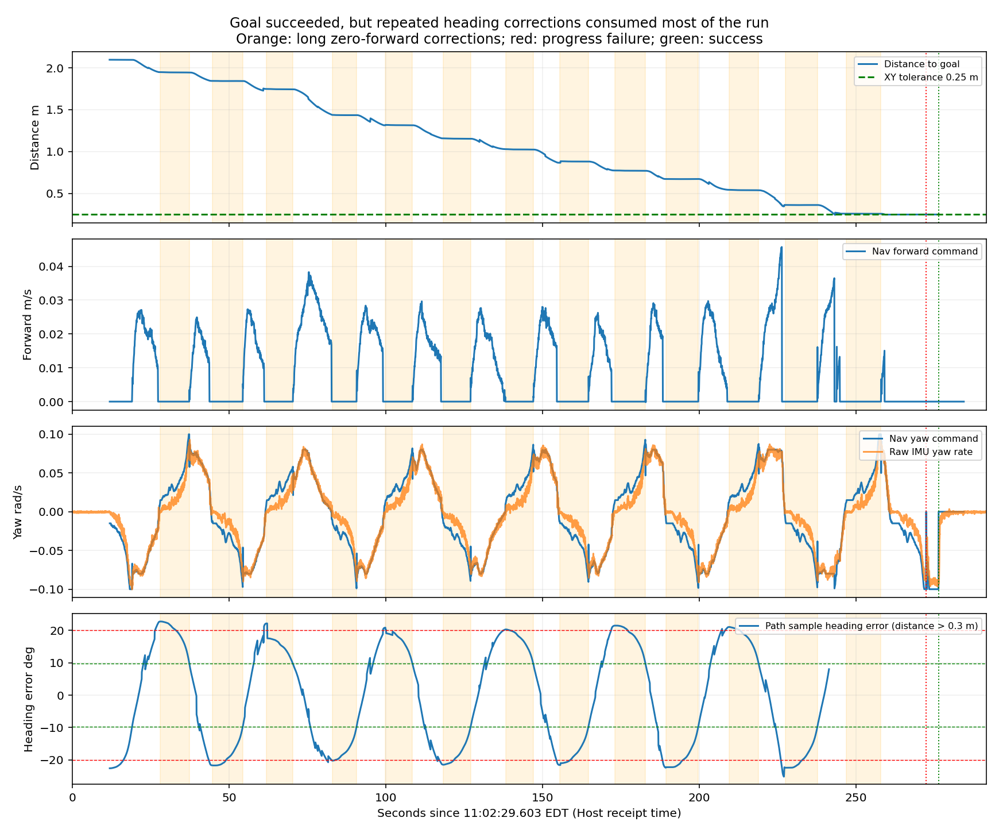
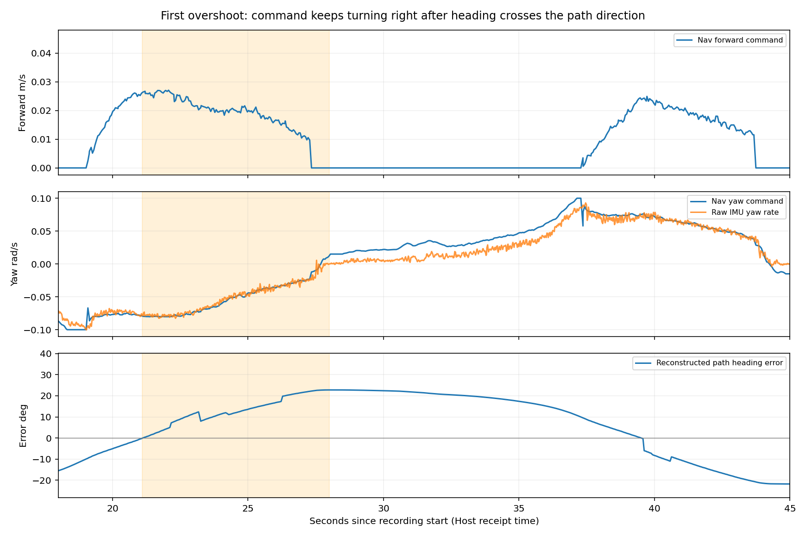

# Jackal: Heading Weight 5.0 Reaches the Goal but Still Corrects Periodically

The bag matches the field observation "reaches the goal, still corrects left and right, but does not stall." Nav2 ultimately succeeds, yet tracking remains unstable. An initial approximately 2.10 m distance takes 264.44 s, including approximately 149.66 s of zero-forward rotation, or 56.6%. Restored Shim repeatedly realigns heading, while MPPI still commands same-direction turning after crossing alignment during forward motion. Success cannot be attributed solely to increased heading weight, and all deviation cannot be explained by inertia or inside-wheel static friction.

Only offline analysis files were generated; navigation YAML, robot parameters, and startup state were unchanged.

## Configuration and data completeness

Directory: `~/Desktop/jackal_rosbag_repo/debug/jackal_20261014_110157/`. Host receipts approximately 2026-10-14 11:02:29.603–11:07:21.172 EDT; 291.57 s, 281024 messages. Recorder shutdown was normal with 4 transport losses. Motor commands/feedback: 14558 / 14563 messages.

| Parameter | Previous 104150 | Current 110157 |
| --- | --- | --- |
| `FollowPath.rotate_to_heading_once` | true | **false** |
| `FollowPath.PathAngleCritic.cost_weight` | 2.0 | **5.0** |
| MPPI / Shim angular limit or target | 0.08 / 0.10 rad/s | Unchanged |
| Smoother angular limit | 0.10 rad/s | Unchanged |
| PoseProgressChecker | 0.20 m OR 0.35 rad, 30 s | Unchanged |

Relative to today's original `102639` baseline, controller_server changes only heading weight. Goals/routes differ between runs, so differences in error ranges cannot directly quantify improvement due to that weight.

After flattening nested YAML and dotted keys, available controller_server, velocity_smoother, chassis-controller, and other before/after parameters match. The final controller_server snapshot used parameter-service fallback; format change is not parameter change.

Nav2 begins lifecycle deactivation/cleanup approximately 9 s after success, before recording ends, so final snapshots miss both costmap nodes. Other key parameters and motion data remain analyzable. Next time end recording and wait for `params_after` before exiting Nav2. No matching external console.log was found; events below use bag `/rosout`, sufficient to verify success, failures, and recoveries.

## Goal sequence and timing

Goal: `(2.905, -0.875)`, final heading approximately −76.49°, starting near `(1.00, 0.00)`. This is not exactly straight along initial heading; it initially requires approximately 23° right adjustment.

| Time from recording start | Event |
| --- | --- |
| 11.87 s | The only navigation goal is received. |
| 11.92–19.02 s | Initial zero-forward turn reduces sampled-path error from approximately −22.6° to −9.9°. |
| 28–258 s | Repeated left/right deviation, in-place correction, and forward motion; 13 corrections last at least 3 s, typically approximately 8–11 s. |
| 221.85 s | First enters the 0.50 m goal region. |
| 243.07 s | First enters 0.25 m position tolerance, followed by corrections near the boundary and final-heading alignment. |
| 272.32 s | One `Failed to make progress`; local_costmap is cleared and tracking retried. |
| 276.31 s | `Goal succeeded`, action SUCCEEDED; not cancellation or replacement by a new goal. |

Final feedback is approximately 0.248 m from the goal with 14.01° heading error, consistent with 0.25 m / 0.25 rad (14.32°) tolerances. Success means meeting these tolerances, not reaching the exact target center with near-zero orientation error.

Zero-forward rotation totals approximately 149.66 s, 56.6% of navigation. For commands above 0.005 m/s forward, median forward speed is approximately 0.0204 m/s and maximum only 0.0457 m/s, well below the 0.20 m/s cap. Raising that cap alone may not speed this run; corrections and tiny actual commands dominate time.



Orange marks long repeated zero-forward corrections, red progress failure, and green success. To avoid confusing final-heading alignment with tracking error, the bottom direction-error plot shows only points more than 0.30 m from the goal.

## Left-right oscillation follows alternating, sustained angular commands

After initial alignment and while more than 0.5 m from the goal, reconstructed path-direction error is approximately **−22.4° to +22.8°**. This repeatedly cycles through Shim's approximately 20° engagement / 10° disengagement thresholds.

Reconstruction uses a recorded path sample approximately 0.5 m ahead and navigation pose. It is neither exact MPPI critic input nor direct per-cycle Shim/MPPI mode telemetry. Correction start/end angles, zero-forward commands, and source logic jointly support repeated Shim engagement. [Rotation Shim implementation](https://github.com/ros-navigation/navigation2/blob/1.3.12/nav2_rotation_shim_controller/src/nav2_rotation_shim_controller.cpp)

For the first forward segment after handoff, positive error means the sample is already left of the body, so continued right turning increases deviation:

| Time | Reconstructed error | Nav2 angular command | Raw IMU angular speed |
| --- | --- | --- | --- |
| 21 s | −0.45°, nearly aligned | −0.0784 rad/s | −0.0785 rad/s |
| 22 s | +4.52° | −0.0802 rad/s | −0.0785 rad/s |
| 25 s | +13.50° | −0.0447 rad/s | −0.0471 rad/s |
| 27 s | +21.60° | −0.0256 rad/s | −0.0215 rad/s |
| 28 s | +22.77° | +0.0116 rad/s, beginning reversal | −0.0002 rad/s |

After crossing alignment, upstream commands still request right turning and body motion broadly follows them. This is not evidence of several seconds of same-direction sliding after a stop request. During low-speed Shim turn startup, command/measured-speed differences also lengthen correction; distinguish these effects.



For eight sustained turn-sign reversals, delay from chassis command crossing the opposite 0.015 rad/s threshold to IMU crossing 0.005 rad/s that way is approximately 0.004–0.356 s. Sampling, DDS receipts, and threshold definitions affect this statistic; it is not braking calibration. Prolonged inertial rotation alone is not supported as the explanation for sustained deviation above.

## Low-speed inside-wheel stalling remains

For a right turn at 20.54–22.34 s, left target/actual are approximately 0.494 / 0.490 rad/s, while right target is approximately 0.0371 rad/s with zero median actual speed for approximately 1.80 s. Body command is approximately −0.0798 rad/s and IMU approximately −0.0780 rad/s, without clear body overspeed.

The same occurs leftward: at 71.20–73.92 s, left target is approximately 0.0408 rad/s with zero median actual speed, while right target/actual are approximately 0.403 / 0.396 rad/s for 2.72 s. Both sides show low-speed error, with no drive-fault flags or emergency stop. This cannot diagnose a failed motor or separate static friction, low-speed drive dynamics, and encoder quantization contributions.

When both sides are commanded forward and the outside keeps moving, a stalled inside wheel may increase actual curvature. The stronger oscillation evidence here remains upstream angular commands alternating and persisting too long in one direction. Independently calibrate minimum stable wheel speed and verify Nav2 tracking.

## Why progress still fails while rotating

During approximately 30 s before failure, navigation feedback shows only approximately 0.025 m endpoint displacement and 1.75° net heading change. Left/right turning occurs between them but returns near the starting heading, so accumulated rotation is not effective pose progress.

PoseProgressChecker measures distance/angle from its reference pose, not accumulated wheel rotation or fixed-distance replanning checkpoints. Corrections near the position-tolerance boundary may fail to exceed 0.20 m or 0.35 rad. This event clears the local map and retries, succeeding approximately 4 s later without Spin/BackUp/Wait. Prioritize reducing ineffective corrections rather than relaxing progress checks merely to remove the log.

## Next: capture MPPI internal trajectories

`FollowPath.visualize: false` leaves subscribed `optimal_trajectory`, `transformed_global_plan`, and `/trajectories` with **0 messages**. Output behavior is abnormal, but this bag cannot distinguish predicted future realignment, local-path transform errors, or critic tradeoffs. Increasing heading weight from 2.0 to 5.0 did not remove repeated correction; do not further raise weight or lower speed before collecting this evidence.

Cancel the goal, stop the robot, and start current Nav2 normally. Apply these runtime settings on Jackal. The first two reproduce this run after restart; the last three enable diagnostic trajectories while reducing candidate visualization density:

```bash
source /etc/clearpath/setup.bash
ros2 param set /j100_0949/controller_server FollowPath.rotate_to_heading_once false
ros2 param set /j100_0949/controller_server FollowPath.PathAngleCritic.cost_weight 5.0
ros2 param set /j100_0949/controller_server FollowPath.TrajectoryVisualizer.trajectory_step 1500
ros2 param set /j100_0949/controller_server FollowPath.TrajectoryVisualizer.time_step 80
ros2 param set /j100_0949/controller_server FollowPath.visualize true

ros2 param get /j100_0949/controller_server FollowPath.rotate_to_heading_once
ros2 param get /j100_0949/controller_server FollowPath.PathAngleCritic.cost_weight
ros2 param get /j100_0949/controller_server FollowPath.visualize
```

Expect `False`, `5.0`, and `True`. `trajectory_step` / `time_step` affect candidate visualization sampling only; optimizer `batch_size: 1500` and `time_steps: 80` remain unchanged, and the full optimal trajectory is published. Sparse candidate display reduces recording bandwidth and visualization load. [MPPI trajectory publication](https://github.com/ros-navigation/navigation2/blob/1.3.12/nav2_mppi_controller/src/trajectory_visualizer.cpp)

Use the existing Host script without changing the topic list:

```bash
cd ~/Desktop/Jackal_Turtlebot_Platform
bash scripts/record_jackal_debug.sh
```

After Space starts recording, first test a goal approximately 2 m straight ahead from the same start/heading with adequate clearance. Point the goal arrow along the path to separate final-heading alignment from tracking, then reproduce this run's small-angle goal. During navigation with MPPI controlling, verify in another terminal:

```bash
ros2 topic hz /j100_0949/optimal_trajectory
ros2 topic hz /j100_0949/transformed_global_plan
```

MPPI trajectories may pause during Shim in-place turning; check during forward tracking. After arrival or cancellation and stopping, record a few more seconds, press Ctrl+C, and wait for final snapshots before shutting down Nav2. Set `FollowPath.visualize` back to `false` afterward if desired; these commands do not write YAML.

## Other limitations and verification

Largest adjacent `map → odom_start` correction has translation-component change approximately 0.124 m and heading 2.40°, not measured physical sideslip. Host/robot stamps differ by approximately 2.132 s across streams, not established motor-response delay. A few control warnings occur; 5.24 Hz is during a post-failure clear/retry, not the continuous frequency.

Verification files: [goal_metrics.json](goal_metrics.json), [summary.json](summary.json), [rosout.txt](rosout.txt), [inner_wheel_intervals.csv](inner_wheel_intervals.csv), [zero_forward_turn_windows.csv](zero_forward_turn_windows.csv). Offline scripts: [extract.py](extract.py), [analyze.py](analyze.py), [metrics.py](metrics.py).
