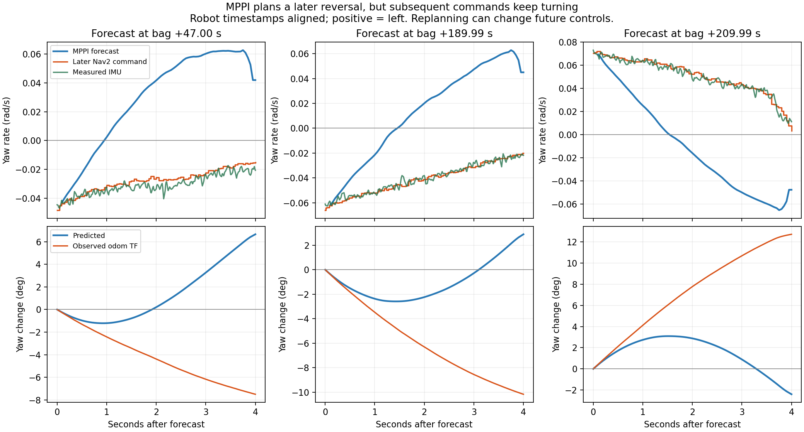

# Jackal: MPPI Predicted Realignment Differs from Later Commands; Next Compare RPP

This run captured MPPI optimal trajectories. Goal 1 succeeded; goal 2 was canceled after repeated corrections, with no progress failures or Spin/BackUp/Wait. Multiple intervals show **the current prediction schedules a later opposite-direction correction, but subsequently recomputed commands keep turning the original way, and IMU broadly follows those later commands**. Inertia or low-speed wheel stalling alone cannot explain current oscillation.

Following the user's choice, a separate [indoor RPP candidate](../../config/jackal/nav2_low_speed_indoor_rpp.yaml) and [deployment, readback, recording, and rollback instructions](../../Docs/Jackal_RPP_Trial_2026-10-14.md) were prepared. At this stage they were not deployed to Jackal and no motion test was performed.

## Data and runtime settings

Source: `/home/nyu/Desktop/jackal_rosbag_repo/debug/jackal_20261014_112127/`. Host recording starts 2026-10-14 11:22:04.954 EDT, lasts **297.92 s**, and contains **293711 messages**. Normal shutdown reports **5 transport losses**, not attributable to specific topics. Events use bag `/rosout`; no separate matching `robot_logs` were found, without preventing key event verification.

| Setting / data | This run |
| --- | --- |
| Inner tracker | MPPI, wrapped by Rotation Shim |
| `rotate_to_heading_once` | false |
| `PathAngleCritic.cost_weight` | 5.0 |
| MPPI / Shim angular limit or target | 0.08 / 0.10 rad/s |
| Smoother angular limit | ±0.10 rad/s |
| `time_steps × model_dt` | 80 × 0.05 s = 4 s |
| Trajectory visualization | true; candidate display sampling 1500 / 80 |
| Optimal trajectory / transformed reference path | 2270 messages each |
| Navigation velocity commands | 5386 messages |
| Progress check | PoseProgressChecker: 0.20 m OR 0.35 rad, 30 s |

Compared with `110157`, controller_server changes only diagnostic visualization and sparse display; heading weight and Shim settings are unchanged. Controller_server, smoother, and chassis-controller before/after values match after normalizing nested/dotted keys and treating matching NaN unset values as equal.

## Navigation outcome: arrival still costs substantial correction time

| Item | Goal 1 | Goal 2 |
| --- | --- | --- |
| Target coordinates | (−0.097, −1.298) m | (−1.575, −3.301) m |
| Start / end relative to recording | 17.46 / 143.13 s | 150.91 / 294.48 s |
| Outcome | **Succeeded** | **User canceled**, not autonomous failure |
| Initial straight-line distance | 1.70 m | 2.74 m |
| Duration in this run | 125.67 s | 143.57 s |
| Last feedback distance to goal | 0.247 m | 1.696 m |
| Turning with zero forward command | 64.83 s, approximately 51.6% | 84.88 s, approximately 59.1% |
| Median forward command when >0.005 m/s | 0.0254 m/s | 0.0228 m/s |

Goal 1 final heading error is approximately 14.25°, satisfying original `0.25 m / 0.25 rad` tolerances; success does not mean reaching the exact center. Goal 2 minimum straight-line distance is approximately 1.683 m and final remaining path length approximately 1.686 m; those are different metrics.

Initial alignments require approximately 128° right and 50° left, respectively, so these are not cases needing only a slight turn. Later goal 2 tracking repeatedly enters zero-forward correction near ±22° error, resumes near ±10°, then deviates again, matching Shim 20°/10° thresholds. No direct outer-Shim mode flag exists in the bag; mode attribution remains an inference from commands and paths.

At 135.60–143.05 s the robot is near goal 1, mainly aligning final heading; do not classify the entire interval as tracking overshoot. No `Failed to make progress` or recovery execution appears. A few cycle warnings around 17–20 Hz do not support persistently very low control frequency as the cause.

## Predicted realignment does not appear promptly in later commands

The plot aligns robot message stamps. Positive angular velocity means left; negative means right. Blue is one MPPI prediction, orange later actual Nav2 commands, and green IMU.



Example optimal trajectory at recording time **47.003 s**:

| Time after prediction | Predicted angular velocity | Later Nav2 command | IMU angular velocity |
| --- | --- | --- | --- |
| 0.5 s | −0.0227 | −0.0387 | −0.0371 |
| 1.0 s | +0.0024 | −0.0309 | −0.0330 |
| 2.0 s | +0.0417 | −0.0256 | −0.0335 |
| 3.0 s | +0.0603 | −0.0225 | −0.0241 |
| 4.0 s | +0.0420 | −0.0152 | −0.0207 |

All values are rad/s. The prediction begins turning left after approximately 1 s, but subsequent commands remain rightward throughout 4 s. Predicted endpoint heading implies **6.66° net left rotation** over 4 s, while odom TF shows **7.51° net right rotation** over the same interval. At 50 s another prediction forecasts 9.76° net left, while actual rotation remains 3.67° net right.

Goal 2 repeats similar relationships:

| Prediction publication time relative to recording | Predicted net rotation over next 4 s | Odom TF net rotation over same interval |
| --- | --- | --- |
| 189.99 s | +2.89° | −10.17° |
| 209.99 s | −2.40° | +12.72° |
| 230.02 s | +4.47° | −8.96° |
| 249.99 s | −3.99° | +5.19° |

This confirms repeated correction is not solely downstream execution: upstream commands themselves do not reverse promptly as earlier forecasts suggested. **Prediction/actual disagreement alone does not prove an MPPI code bug.** MPPI reoptimizes each cycle and executes only the current selected action; future sequences are not mandatory schedules, and path/state changes alter them. Source also shows visualization uses filtered, shifted control sequences, creating approximately one-cycle uncertainty in first-step alignment. This approximately 0.05 s difference cannot explain several-second discrepancies. [MPPI optimizer and optimal trajectory](https://github.com/ros-navigation/navigation2/blob/1.3.12/nav2_mppi_controller/src/optimizer.cpp)

## Coordinate and chassis checks: scope and limits

Both optimal trajectory and transformed reference path use `odom`. The first integrated optimal point is a median approximately **1.17 mm** from simultaneous `odom → base_link`, with 2.49 mm 95th percentile and median heading difference 0.16°. That point already integrates one step beyond the starting state; these small differences do not support an overall 180° frame error.

Largest adjacent `map → odom_start` heading correction occurs at **45.89 s**, approximately **10.20°**, affecting body/global-path alignment and requiring consideration. However, later 190–194 s and 210–214 s comparisons still show command mismatch, with maximum individual map heading corrections only approximately 1.40° and 1.80°. This report does not force one explanation for all effects or treat map corrections as physical slip angles.

Inside-wheel low-speed stalling remains. At 42.25–43.85 s, right target is approximately `0.0487 rad/s` with zero median feedback; left target/actual are approximately `0.4944 / 0.4887 rad/s`. IMU is approximately `−0.0786 rad/s`, close to body command `−0.0792 rad/s`. Both sides show similar intervals, without motor faults or emergency-stop triggers. This establishes low-speed error but cannot separate static friction, encoder quantization, drive regulation, and lateral slip contributions.

Median Host receipt/robot stamp difference is approximately **2.161 s**, mixing clock-reference difference, transport, and other factors; it is not measured 2.161 s motor latency. Same-interval plot comparisons use robot stamps; log events are approximately mapped to recording-relative time by adding that offset.

## Next run: Shim + RPP

The user selected RPP; see the [dedicated instructions](../../Docs/Jackal_RPP_Trial_2026-10-14.md) for full configuration/operation. Core settings: desired forward `0.06 m/s`, fixed lookahead `0.6 m`, curvature regulation enabled, Shim `0.10 rad/s`, shared angular limit `0.10 rad/s`. RPP in-place alignment is disabled in favor of outer Shim. MPPI critics, horizon, and sampling parameters are removed from the new FollowPath configuration.

Do not further relax progress checks or change chassis geometry in this comparison. Use the same start/goal and goal arrow along travel for straight/small-angle routes. Compare success, duration, forward-phase direction error, in-place correction counts, and lookahead changes. Controller, desired speed, and regulation method all change, so the next outcome cannot be attributed to one parameter alone.

## Reproduction and files

The original bag remains unchanged. Extract data in the existing environment, then run offline scripts; the robot need not start:

```bash
cd /home/nyu/Desktop/Jackal_Turtlebot_Platform
source /opt/ros/jazzy/setup.bash
python3 analysis/jackal_20261014_112127/extract.py
python3 analysis/jackal_20261014_112127/analyze.py
python3 analysis/jackal_20261014_112127/forecast_analysis.py
```

- [forecast_summary.json](forecast_summary.json): goal results, coordinate checks, and predicted/actual interval rotations.
- [forecast_vs_commands.csv](forecast_vs_commands.csv): forecast time, future time, predicted commands, later commands, and IMU samples.
- [zero_forward_turn_windows.csv](zero_forward_turn_windows.csv): zero-forward turn windows, not directly recorded Shim states.
- [inner_wheel_intervals.csv](inner_wheel_intervals.csv), [wheel_tracking_by_speed.csv](wheel_tracking_by_speed.csv): low-speed wheel intervals and tracking errors.
- [rosout.txt](rosout.txt): navigation and related node logs for this run.

RPP candidate checks passed: no duplicate YAML keys, ROS parameter parsing, names matching installed Jazzy RPP 1.3.12, changes limited to FollowPath and proportional smoother scaling, syntax checks for 9 Bash blocks, and no duplicates in 56 recording topics. An ideal geometric sweep with fixed 0.6 m lookahead also fits the candidate's approximately 0.10 rad/s design range. This does not validate physical braking, slip, or navigation clearance. Check Jackal plugin installation and actual loading using the manual.
