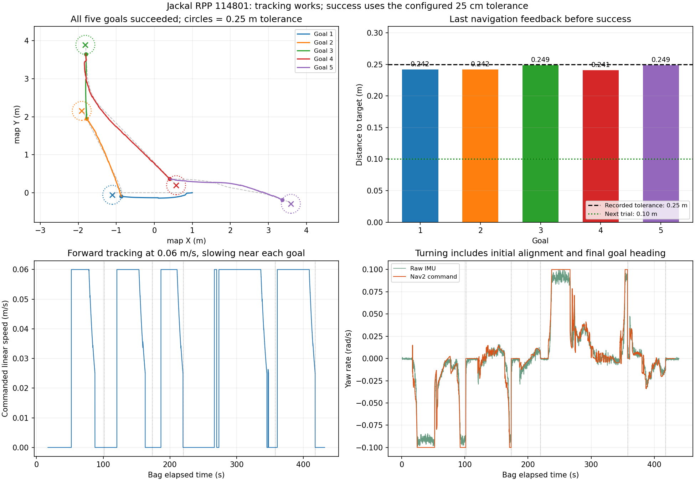

# Jackal RPP: Five Successes; Approximately 0.24 m Early Arrival Explained by Position Tolerance

The bag matches the field observation "tracking is normal": **all 5 goals succeed, with no progress failures, Spin/BackUp/Wait recoveries, or control-loop overrun warnings.** Last position feedback before each success is approximately **0.241–0.249 m** from the goal, while runtime `general_goal_checker.xy_goal_tolerance` is exactly **0.25 m**. Early arrival indication is therefore mainly permitted by the goal criterion.

The user selected **0.10 m** for the next run. The Host [RPP YAML](../../config/jackal/nav2_low_speed_indoor_rpp.yaml) is updated; tracking, speed, Shim, heading tolerance, progress, and footprint retain this run's settings. Jackal runtime parameters have not been changed. See [operating manual sections 2–4](../../Docs/Jackal_RPP_Trial_2026-10-14.md#2-upload-the-configuration-and-start-pose-script--host) for persistent deployment, and the runtime command below for an immediate comparison.

## Data for this run

Bag: `/home/nyu/Desktop/jackal_rosbag_repo/debug/jackal_rpp_20261014_114801/bag`. Duration 439.12 s, 435844 messages; normal recorder shutdown with 3 transport losses. RPP local reference path, lookahead point, and curvature lookahead point each have 4885 messages, sufficient to inspect this run's tracking output.

The loaded inner controller is RPP, with desired forward `0.06 m/s`, fixed lookahead `0.6 m`, Shim `0.10 rad/s`, and smoother angular limit `±0.10 rad/s`. Controller_server, smoother, and chassis-controller before/after parameters match, with no parameter-change events in the bag.

## Results for five goals

Distances compare final navigation pose feedback with the goal's global-path endpoint; feedback precedes success logs by approximately 20–21 ms. Every replan for a goal has exactly the same endpoint, matching target coordinates in navigation-start logs to their two-decimal precision. There is no evidence the planner selected an endpoint 0.2 m short.

| Goal | Target (m) | Initial straight-line distance | Duration | Distance before success | Absolute final heading error |
| --- | --- | --- | --- | --- | --- |
| 1 | (−1.107, −0.055) | 2.108 m | 84.50 s | **0.242 m** | 14.23° |
| 2 | (−1.909, 2.154) | 2.480 m | 53.00 s | **0.242 m** | 13.97° |
| 3 | (−1.814, 3.891) | 1.941 m | 33.15 s | **0.249 m** | 6.23° |
| 4 | (0.573, 0.198) | 4.190 m | 125.50 s | **0.241 m** | 14.13° |
| 5 | (3.593, −0.291) | 3.259 m | 56.90 s | **0.249 m** | 11.25° |

All five show `Goal succeeded` and action SUCCEEDED, without cancellation or preemption. Goals 1/4 include substantial initial alignment; goals 1/2/4 also align final heading after entering position tolerance, which must not all be counted as oscillation. Goal 4 has one approximately 3.3 s zero-forward turn early in tracking after initial alignment, but no sustained repeating correction cycle like the previous run. Goals 3/5 have no zero-forward turn longer than 1 s.



Top-left circles show this run's 0.25 m goal tolerance; crosses are targets; filled trajectory endpoints are the last positions before success. The top-right green line is the planned next-run 0.10 m tolerance, not a measured result from this run.

## Why success occurs while still 0.2 m away

Actual parameters:

```yaml
general_goal_checker:
  plugin: nav2_controller::SimpleGoalChecker
  stateful: true
  xy_goal_tolerance: 0.25
  yaw_goal_tolerance: 0.25
```

`xy_goal_tolerance: 0.25` is the allowed position-error radius. With `stateful: true`, entering that region is remembered while waiting for heading to meet its criterion. `yaw_goal_tolerance: 0.25` is radians, approximately 14.3°. Shim final-heading control also reads the goal checker's position tolerance, so it may stop advancing and align orientation upon entering approximately 0.25 m. [SimpleGoalChecker](https://github.com/ros-navigation/navigation2/blob/1.3.12/nav2_controller/plugins/simple_goal_checker.cpp), [Rotation Shim](https://github.com/ros-navigation/navigation2/blob/1.3.12/nav2_rotation_shim_controller/src/nav2_rotation_shim_controller.cpp)

This explains why all five success distances cluster at 0.24–0.25 m. Exact target-center arrival is not required, and this is not a stopping distance set by angular deceleration. `progress_checker.required_movement_radius: 0.2` checks sufficient pose change over time; it is distinct from arrival tolerance and need not change here.

The distance is from localized `base_link` to the target, not from the front bumper. Tightening to 0.10 m does not guarantee externally measured accuracy; localization error, positional drift while turning, and stateful checking affect the final resting position.

## Tracking-output checks

Each goal's median forward command is **0.06 m/s**. During RPP tracking, median absolute angular command is approximately **0.0076 rad/s**, with **0.0328 rad/s** at the 95th percentile. Normal small corrections are already far below the shared angular cap; early arrival does not require lowering turning speed again.

All 4885 curvature lookahead samples match navigation commands within a 30 ms receipt-time window. Reconstructing angular velocity with `ω = v × 2y / (x²+y²)` gives zero median/95th-percentile error and approximately `0.000084 rad/s` maximum, showing published RPP commands agree with geometric lookahead. [RPP control implementation](https://github.com/ros-navigation/navigation2/blob/1.3.12/nav2_regulated_pure_pursuit_controller/src/regulated_pure_pursuit_controller.cpp)

Nearest distance from body origin to the **then-current replanned local reference polyline** has median approximately **1.76 cm**, 95th percentile **3.50 cm**, and maximum **7.66 cm**. This supports stable tracking in this run, but a replanned reference is not fixed accuracy against the initial line and is not physical localization accuracy. Goals/routes differ across runs; no fixed RPP-versus-MPPI improvement percentage is claimed.

## Next run: change only position tolerance

Current Host configuration is now:

```yaml
general_goal_checker:
  stateful: true
  plugin: nav2_controller::SimpleGoalChecker
  xy_goal_tolerance: 0.10
  yaw_goal_tolerance: 0.25
```

After canceling the goal and stopping Jackal, temporarily change this in another terminal while Nav2 runs:

```bash
source /etc/clearpath/setup.bash
ros2 param set /j100_0949/controller_server general_goal_checker.xy_goal_tolerance 0.10
ros2 param get /j100_0949/controller_server general_goal_checker.xy_goal_tolerance
```

Expect `Double value is: 0.1`. Then **send the goal again**; a previously successful goal will not automatically continue closer. Runtime changes do not write YAML. Restart must load the updated file; upload, backup, selection, and readback are in the [dedicated operating manual](../../Docs/Jackal_RPP_Trial_2026-10-14.md).

Record a comparison with the same start, target position, and target heading. Check whether success distance approaches 0.10 m and whether the endpoint converges stably. Retain heading tolerance, desired speed, lookahead, progress, and Shim initially.

## Other logs and data limits

No motor-fault flags appear. The chassis reports 94 stale-command warnings, all after navigation succeeds. The five referenced stamps correspond to zero linear/angular messages at goal completion, not execution intervals. These warnings do not explain early success and do not justify extending chassis command timeout for this run.

Nav2 had already begun exiting before recording ended, so final snapshots missed both costmaps; key controller/smoother/chassis values remain checkable. Next time press Ctrl+C to end recording, wait for `params_after` and `Saved`, then exit Nav2.

## Reproduction and files

```bash
cd /home/nyu/Desktop/Jackal_Turtlebot_Platform
source /opt/ros/jazzy/setup.bash
python3 analysis/jackal_rpp_20261014_114801/extract.py
python3 analysis/jackal_rpp_20261014_114801/analyze.py
```

- [summary.json](summary.json): outcomes, RPP output checks, and warning statistics.
- [goal_results.csv](goal_results.csv): per-goal distances, heading errors, and times.
- [local_plan_distance.csv](local_plan_distance.csv): distance to the then-current local reference path.
- [zero_forward_turn_windows.csv](zero_forward_turn_windows.csv): zero-forward turns lasting at least 1 s, not directly recorded Shim state.
- [rosout.txt](rosout.txt): bag logs.

The original bag and snapshots remain unchanged. This configuration change only tightens position tolerance in the Host RPP YAML; it was not deployed or applied online to the robot.
